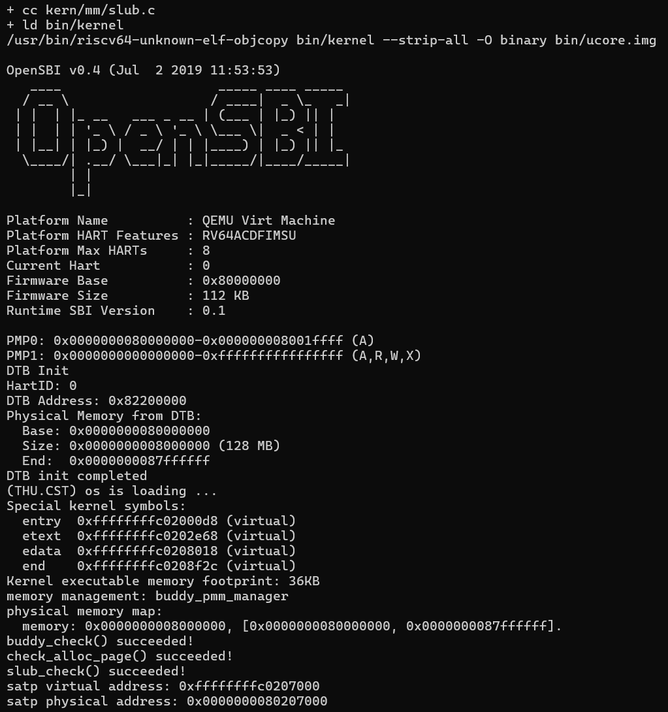
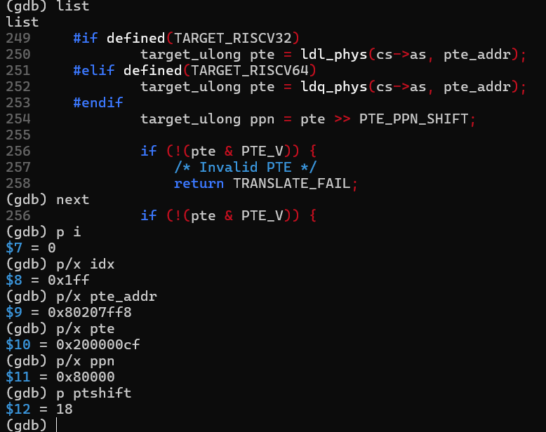
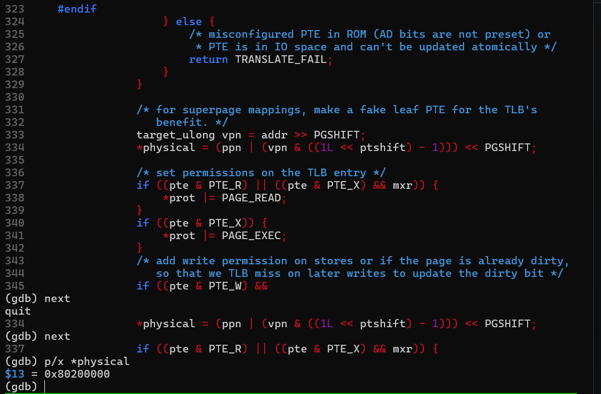
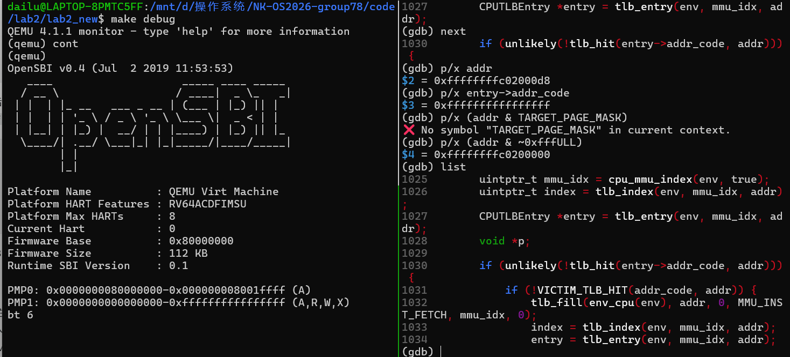
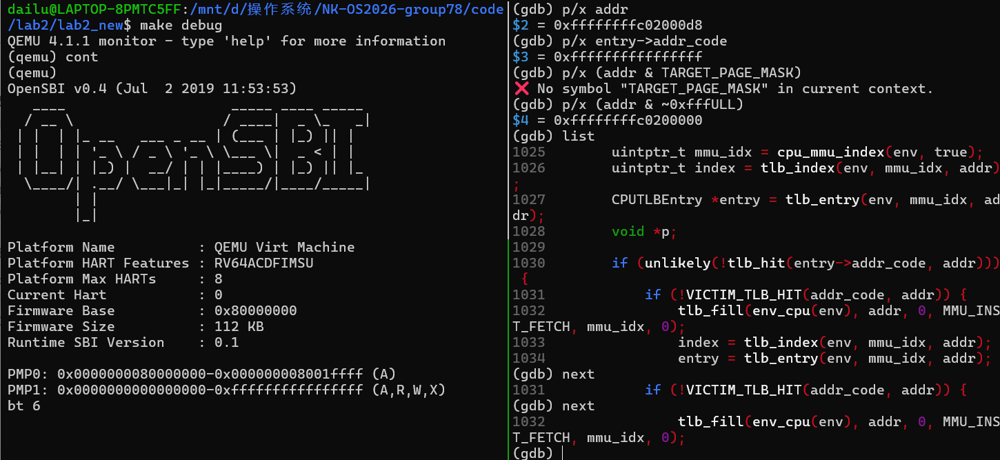
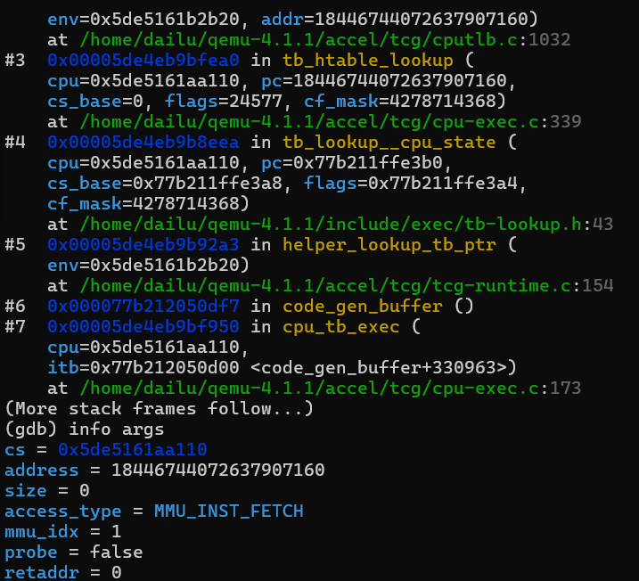

# 操作系统实验报告

## 实验基本信息

| 项目 | 内容 |
|------|------|
| **实验名称** | Lab 2: 物理内存管理 |
| **小组成员** | 2413410-韩芳逸、2413993-徐锐、2413340-戴璐 |
| **完成日期** | 2026-10-17 |

### 小组分工

练习如何分工？

| 成员 | 负责的练习/模块 |
|------|----------------|
| 2413410-韩芳逸 | 功能模块一：物理内存初始化（`page_init()`），扩展任务 |
| 2413993-徐锐 | 功能模块二：任务一，任务二，任务三 |
| 2413340-戴璐 | 功能模块二：扩展任务；分支任务 |

实验报告如何分工？

---

## 一、实验目的

<!-- 说明本次实验的主要目标和预期成果 -->

本实验的主要目的是：

1. 理解物理内存在操作系统启动链路中的角色：内核如何从设备树（DTB）发现物理内存、如何用 `Page` 描述符数组组织物理页、如何把可用页面交给物理内存管理器。
2. 掌握虚拟地址、物理地址、物理页号（PPN）与 `Page` 描述符地址四者之间的区别和换算关系，理解 Sv39 分页下内核高地址虚拟空间与物理地址之间的固定偏移 `PHYSICAL_MEMORY_OFFSET`。
3. 掌握 `struct pmm_manager` 抽象接口，理解 `init/init_memmap/alloc_pages/free_pages/nr_free_pages/check` 各成员的职责，以及物理内存管理器与上层分配逻辑的解耦方式。
4. 通过阅读 First-Fit 实现，理解连续物理页的初始化、分配、回收以及相邻空闲块合并的完整过程，并能分析其碎片问题。
5. 能够独立设计 Best-Fit 连续物理内存分配算法并接入现有框架，进一步了解 Buddy System（页级按 2 的幂拆分/合并）与 SLUB（页级之上的任意大小对象分配）两种分配思想。


---

## 二、实验环境

你们使用的 AI 工具

| 成员 | AI 编程工具 | 底层模型 | 备注 |
|------|------------|---------|------|
| 2413410-韩芳逸 | Claude Code（VS Code 扩展） | DeepSeek-V4-Flash | 用于代码阅读、提示词迭代、编译与 QEMU 验证 |
| 2413993-徐锐 | Codex(VScode插件)，ChatGPT桌面版 | GPT6 | |
| 2413340-戴璐 | Codex(VScode插件)，ChatGPT桌面版 |GPT-6 Sol | |

**说明：**
- **AI 编程工具**：指具体使用的终端工具、编辑器插件、桌面应用或浏览器界面
- **底层模型**：指该工具使用的大语言模型及版本

---

## 三、实验整体逻辑分析

### 2.1 本章节的逻辑主线

本章围绕**物理内存的发现、组织与分配**这一核心主题展开，要解决的问题是：内核启动后，如何知道机器上有多少可用物理内存，如何把这些内存组织成可管理的页，并在此基础上提供页面分配与回收能力，为后续虚拟内存、进程管理等子系统打下基础。

整条实现链可以分为两条交织的线索：

- **元数据线索（地址与描述符）**：从设备树获取物理内存范围 → 设置内核虚拟/物理地址偏移 `va_pa_offset` → 确定可管理页号上界 `npage` → 在内核镜像结尾 `end` 之后建立 `Page` 描述符数组 `pages` → 把 OpenSBI、内核镜像、描述符数组自身占用的页面标记为保留。
- **分配器线索（策略与数据结构）**：选定 `pmm_manager` → 把剩余完整空闲页注册为空闲块 → 实现分配/释放/合并策略（First-Fit、Best-Fit，扩展任务中的 Buddy、SLUB）→ 由检查函数验证分配器的正确性。

两条线索在 `init_memmap()` 处汇合：`page_init()` 负责"有哪些页可管"，分配器负责"这些页怎么分配"。整体调用链为：

```
kern_init() → dtb_init() → pmm_init()
    → init_pmm_manager()    选定并初始化 pmm_manager
    → page_init()           探测内存、建立描述符、注册空闲页
    → init_memmap()         pmm_manager->init_memmap()
    → check_alloc_page()    pmm_manager->check()
后续：alloc_pages()/free_pages() 提供页面级内存服务
```

### 2.2 功能的逐步实现

本章实验按照"先建立元数据，再实现分配策略，最后扩展更复杂的分配器"的顺序逐步实现：

1. **首先实现功能模块一：物理内存初始化（`page_init()`）** → 这是后续一切物理内存管理的基础。没有正确的 `pages`、`npage`、`va_pa_offset` 和初始空闲页链表，分配器就无从谈起；同时该函数还决定了哪些页面是保留的，直接影响内核自身的安全。
2. **接着理解 First-Fit 分配器（思考题）** → 框架已提供 `default_pmm.c` 的完整实现作为参照。通过阅读 `default_init`、`default_init_memmap`、`default_alloc_pages`、`default_free_pages`，掌握空闲链表、`property` 块长度、相邻块合并等约定，为自行实现 Best-Fit 建立接口和状态约定上的参照。
3. **然后实现并接入 Best-Fit 分配器** → 在相同的 `pmm_manager` 接口下替换分配策略，需要自行设计内部空闲链表和注册结构 `best_fit_pmm_manager`，并在 `init_pmm_manager()` 中切换管理器。这一步验证了"分配算法可插拔"的抽象设计，也暴露了 First-Fit 在减少外部碎片方面的不足。
4. **最后完成 Buddy System 与 SLUB 扩展任务** → Buddy System 在页级用 2 的幂大小的块进行拆分与合并，与前两种连续分配算法形成对比；SLUB 则在页级分配之上再构建任意大小对象的缓存层，形成"页分配器 + 对象分配器"的两层架构。二者都需要自行设计提示词和测试，是对分配器设计能力的综合检验。


---

## 四、实验内容与实现

<!-- 
说明：本部分按照 exercises 文档中的练习顺序组织
每个功能模块或者练习中可能包含多项任务，请根据实际情况调整
-->

### 功能模块：物理内存初始化
**负责人：** 2413410-[韩芳逸]

#### 模块功能描述

**需要实现/修改的函数：**

```c
static void page_init(void);
```

**本模块依赖的框架函数与符号（已提供，无需实现）：**

```c
uint64_t get_memory_base(void);
uint64_t get_memory_size(void);
static void init_memmap(struct Page *base, size_t n);
static inline struct Page *pa2page(uintptr_t pa);
```

此外还使用 `PADDR()`、`ROUNDUP()`、`ROUNDDOWN()`、`panic()`、`cprintf()` 等框架提供的宏和函数。

**功能说明：**

`page_init()` 位于物理内存初始化的调用链 `pmm_init() -> init_pmm_manager() -> page_init() -> init_memmap()` 中间，负责把设备树探测到的物理内存信息转换成内核可以管理的页描述符布局。它不接收参数、不返回结果，由 `pmm_init()` 在物理内存管理器初始化完成后调用。

本模块主要完成以下工作：

1. **物理内存探测**：通过 `get_memory_base()` 和 `get_memory_size()` 取得设备树报告的内存基址和大小；基址或大小为 0 时说明探测失败，用 `panic()` 终止初始化。
2. **全局状态建立**：设置 `va_pa_offset = PHYSICAL_MEMORY_OFFSET`，使虚拟地址和物理地址可以正确互转；根据内存末端确定 `npage`，并让 `pages` 指向 `end` 之后按页对齐处的 `Page` 描述符数组。
3. **描述符布局**：描述符数组覆盖物理页号区间 `[nbase, npage)`，数组长度为 `npage - nbase`；每个描述符的 `ref`、`property` 清零，`flags` 只置保留位，防止尚未完成布局的页面被提前分配。
4. **已用空间排除**：OpenSBI 占用区 `[0x80000000, 0x80200000)`、内核镜像 `[0x80200000, KernelEnd)` 以及描述符数组本身所在的页面都保持保留状态，不进入空闲区。
5. **空闲区注册**：把描述符数组末尾的物理地址向上按页对齐作为空闲区起点，把内存末端向下按页对齐作为空闲区终点；两者之间非空时，通过 `pa2page()` 找到起始描述符，再用 `init_memmap()` 把这段连续完整页面交给当前 `pmm_manager`。
6. **边界处理**：设备树范围超过 `PHYSICAL_MEMORY_END` 时只管理上界以内的部分；描述符数组之后不足一个完整页面时不调用 `init_memmap()`；最后输出探测到的物理内存范围。

初始化完成后，`page2pa()`、`pa2page()` 依赖的 `pages`、`npage`、`nbase` 均已就绪，后续 `alloc_pages()`、`free_pages()` 可以通过 `pmm_manager` 的空闲页链表完成页面分配与回收。

关键地址关系如下：

| 项目 | 含义 |
| --- | --- |
| `PHYSICAL_MEMORY_OFFSET` | 虚拟地址与物理地址之间的固定偏移 |
| `nbase = DRAM_BASE / PGSIZE` | DRAM 起始物理地址对应的页号 |
| `npage` | 可管理物理内存上界对应的页号 |
| `end` | 内核镜像结束的虚拟地址 |
| `pages` | 描述符数组起始的虚拟地址，位于 `end` 之后并按页对齐 |
| `pages + (npage - nbase)` | 描述符数组末尾，需经 `PADDR()` 转成物理地址 |

#### 最终提示词

以下是经过迭代优化后，最终成功实现该功能的提示词：

````markdown
# 功能模块一 任务一：物理内存探测与页描述符初始化

[PROMPT]

**任务**：修改 `kern/mm/pmm.c`，实现 `page_init()`（以及必要的 `static` 辅助函数），完成物理内存探测与 Page 描述符初始化。函数应根据设备树报告的内存范围，建立覆盖全部可管理物理页的 `Page` 描述符数组，并把排除 OpenSBI、内核镜像和描述符数组自身占用空间后的完整空闲页面交给当前 `pmm_manager` 管理。

**操作要求**：你必须在项目中修改实际文件，保留现有代码，只补全 `page_init()` 的实现；不要修改 `dtb.c`、`default_pmm.c`、测试函数等无关文件。

**输出要求**：直接进行文件操作。以工程中真实的宏、类型和函数为准，使用下面 [RELY]、[GUARANTEE]、[SPECIFICATION] 提供的信息，不要引入无关功能。

[RELY]

宏定义（`kern/mm/memlayout.h`、`kern/mm/mmu.h`、`libs/riscv.h`、`libs/defs.h`）：

```c
#define PGSIZE                 4096
#define PGSHIFT                12
#define PPN(la)                (((uintptr_t)(la)) >> PGSHIFT)
#define DRAM_BASE              0x80000000
#define PHYSICAL_MEMORY_OFFSET 0xFFFFFFFF40000000
#define PHYSICAL_MEMORY_END    0x88000000
```

框架还提供 `PADDR(kva)` 地址转换宏，以及 `ROUNDUP`、`ROUNDDOWN` 页对齐宏。

数据结构（`kern/mm/memlayout.h`）：

```c
struct Page {
    int ref;
    uint64_t flags;
    unsigned int property;
    list_entry_t page_link;
};
```

页面状态宏：`SetPageReserved(page)`、`ClearPageReserved(page)`、`PageReserved(page)`。

全局变量（`kern/mm/pmm.c`、`kern/mm/pmm.h`）：

```c
struct Page *pages;
size_t npage;
uint64_t va_pa_offset;
const size_t nbase = DRAM_BASE / PGSIZE;
```

可用函数与符号：

```c
uint64_t get_memory_base(void);
uint64_t get_memory_size(void);
static void init_memmap(struct Page *base, size_t n);
static inline struct Page *pa2page(uintptr_t pa);
void panic(const char *fmt, ...);
void cprintf(const char *fmt, ...);
extern char end[];
```

[GUARANTEE]

必须实现或修改的接口：

```c
static void page_init(void);
```

你可以根据需要添加 `static` 辅助函数或内部静态变量，但不要改变现有公开接口。

[SPECIFICATION]

## page_init

**Pre-Condition**:
- `pmm_manager` 已由 `init_pmm_manager()` 初始化；
- `dtb_init()` 已把设备树中的内存基址和大小保存下来，可通过 `get_memory_base()`、`get_memory_size()` 获取；
- 内核符号 `end` 是虚拟地址，涉及物理占用计算时必须先用 `PADDR()` 转换。

**Post-Condition**:
- `va_pa_offset` 等于 `PHYSICAL_MEMORY_OFFSET`，保证后续虚拟地址与物理地址可以正确互转；
- `npage` 表示可管理物理内存上界对应的页号，`Page` 描述符数组覆盖 `[nbase, npage)` 中的全部物理页，数组长度为 `npage - nbase`；
- `pages` 指向 `end` 之后按页对齐处的描述符数组，数组中的描述符初始都处于保留状态；
- 当前 `pmm_manager` 只接管描述符数组之后、内存末端之前的完整空闲页；
- 输出探测到的物理内存范围。

**Case 1（正常情况）**：设备树内存范围有效时，先设置 `va_pa_offset` 并确定可管理上界，再在 `end` 之后按页对齐放置描述符数组；将每个描述符的 `ref`、`property` 清零、`flags` 只置保留位，随后计算描述符数组的物理占用，把其后的地址向上按页对齐作为空闲区起点，把内存末端向下按页对齐作为空闲区终点；二者之间非空时，通过 `pa2page()` 找到起始描述符并用 `init_memmap()` 注册这段连续空闲页。最后输出：

```
physical memory map:
  memory: 0x%016lx, [0x%016lx, 0x%016lx].
```

三个值依次为内存大小、内存起始物理地址、内存结束物理地址（末字节地址）。

**Case 2（范围超过可管理上界）**：设备树报告的内存超过了框架能够管理的上界（`PHYSICAL_MEMORY_END`）时，只管理上界以内的部分，超出部分不计入 `npage`，也不加入空闲区。

**Case 3（设备树信息无效）**：内存基址或大小为 0 时，说明探测失败，应通过 `panic()` 终止初始化，不能带着无效范围继续建立描述符。

**Case 4（没有完整空闲页）**：描述符数组之后到内存末端不足一个完整页面时，不得调用 `init_memmap()`，但仍应完成全局变量的设置和内存范围输出。

**Requirements**:
- 全程区分虚拟地址、物理地址、物理页号和 `Page` 描述符地址：`end` 与 `pages` 是虚拟地址，计算描述符数组占用大小时必须转换为物理地址；`PADDR()` 依赖 `va_pa_offset`，必须先设置 `va_pa_offset` 再使用它；
- 描述符数组起点和空闲区起点都向上按页对齐，空闲区终点向下按页对齐，末尾不足一页的部分不参与管理；
- 必须先初始化所有描述符并标记为保留，再交给 `init_memmap()`，确保 OpenSBI 占用区、内核镜像和描述符数组所在的页面不会被后续分配出去；
- 不修改现有测试函数和分配器实现。
````

#### 实现迭代过程

本模块直接使用上述最终版提示词完成实现，没有进行第二次及后续迭代。生成代码后重点检查了以下几点：

- `va_pa_offset` 在第一次使用 `PADDR()` 之前完成设置；
- `pages` 位于 `end` 之后并按页对齐，描述符数组长度为 `npage - nbase`；
- 所有描述符先初始化并置保留位，之后才把空闲区交给 `init_memmap()`；
- 空闲区起点取描述符数组物理末尾向上对齐处，终点取内存末端向下对齐处；
- 设备树信息无效、没有完整空闲页等分支均按要求处理。

**最终结果：**

- ✅ 编译通过
- ✅ 所有相关测试通过
- ✅ 功能符合预期


#### 扩展任务 Challenge：硬件的可用物理内存范围的获取方法


如果 OS 无法提前获知内存范围，最可靠的做法是向固件索取一张内存映射表，而不是索取一个容量数字——因为物理地址空间中间夹着 MMIO 空洞和保留区，“可用内存”本质是若干 {起始, 长度, 类型} 区间的集合。

在 RISC-V 上，固件按启动约定把设备树的物理地址放在 a1 寄存器中传递，内核解析 /memory 节点（device_type = "memory"）的 reg 属性得到基址与长度，本实验即采用此方式；x86 上则由 BIOS 的 int 15h, E820 或 UEFI 的 GetMemoryMap() 返回带类型的内存描述符数组。两条路的共同点是：固件在自检阶段已经枚举了整个物理地址空间，并标注了哪些区间是可用 DRAM、哪些是 MMIO 或保留区，因此信息最可靠。

若没有可用的固件接口，退路是直接读 DRAM 控制器寄存器，但这没有任何标准，只能为每款 SoC 定制。至于主动探测（向候选地址写 pattern 再读回比对，或利用地址线未连接造成的地址回绕），只能在基址已知、仅探测长度的窗口内进行，且风险很高：写入 MMIO 可能产生副作用（复位设备、关时钟）而不报错；访问不存在的物理地址在 RISC-V 上触发的是 access fault 而非 page fault，需要 trap 框架先就绪，而内存管理初始化往往早于 trap 初始化；真实硬件上还可能直接挂总线。因此现代系统基本只在 bootloader 阶段做探测。

无论用哪种方式，拿到的都只是“原始可用范围”。OS 还必须扣除固件（OpenSBI 占用的低 2 MiB）、内核镜像、Page 描述符数组自身、设备树本身以及启动栈等保留区，并对齐到页边界，才是能交给页面分配器的空闲页。

---

### 功能模块：物理内存分配功能

**负责人：** 2413993-徐锐，2413340-戴璐

#### 模块功能描述

**需要实现/修改的函数：**

```c
// 任务一：理解已有 First-Fit 实现，无需修改
// 任务二：实现 Best-Fit，保留已有测试
static void best_fit_init(void);
static void best_fit_init_memmap(struct Page *base, size_t n);
static struct Page *best_fit_alloc_pages(size_t n);
static void best_fit_free_pages(struct Page *base, size_t n);
static size_t best_fit_nr_free_pages(void);
static void init_pmm_manager(void);//选择Best-fit分配器
// 任务三：实现 Buddy System 及其测试
static void buddy_init(void);
static void buddy_init_memmap(struct Page *base, size_t n);
static struct Page *buddy_alloc_pages(size_t n);
static void buddy_free_pages(struct Page *base, size_t n);
static size_t buddy_nr_free_pages(void);
static void buddy_check(void);
static void init_pmm_manager(void);//选择Buddy system分配器
// 扩展任务：在页分配器之上新增 SLUB 对象分配接口及自检
void slub_init(void);
void *slub_alloc(size_t size);
void slub_free(void *ptr);
void slub_check(void);
```

**功能说明：**

- 该模块在系统中的作用

  以页为单位分配和回收连续物理内存，为内核提供物理页面管理服务。

- 需要处理哪些主要场景
  初始空闲页登记、连续页申请、空闲块拆分、页面回收和相邻空闲块合并。

- 如何与其他模块交互
  `page_init()` 通过 `init_memmap()` 交付可用页；内核通过 `alloc_pages()`、`free_pages()` 申请和释放页面。这些接口由 `pmm_manager` 转发到选定的分配器实现。

#### 任务一：理解 first-fit 连续物理内存分配算法

First-Fit 始终维护一条**按物理地址递增排列的空闲块链表**，每个结点代表一个连续空闲块，由块首页记录页数。

1. **初始化：** `default_init()` 建立空链表；`page_init()` 确定可用页面后，由 `default_init_memmap()` 将它们登记为空闲块。

   ```mermaid
   %%{init: {"themeVariables": {"fontSize": "13px"}, "flowchart": {"nodeSpacing": 15, "rankSpacing": 20}}}%%
   flowchart TD
       A[default_init：空链表，nr_free = 0] --> B[page_init：排除保留区]
       B --> C[default_init_memmap：重置可用页描述符]
       C --> D[设置块首页与页数，按地址入链表]
       D --> E[nr_free 加 n，完成登记]
   ```

2. **分配：** `default_alloc_pages(n)` 从链表头找到第一个至少有 `n` 页的块，取出前 `n` 页；若有剩余，就把剩余块留在原位置。找不到合适块则申请失败。

   ```mermaid
   %%{init: {"themeVariables": {"fontSize": "13px"}, "flowchart": {"nodeSpacing": 15, "rankSpacing": 20}}}%%
   flowchart TD
       A[default_alloc_pages：申请 n 页] --> B{nr_free 足够？}
       B -- 否 --> X[返回 NULL]
       B -- 是 --> C[从头查找首个足够大的块]
       C --> D{找到？}
       D -- 否 --> X
       D -- 是 --> E[摘下该块，取前 n 页]
       E --> F{有剩余？}
       F -- 是 --> G[设置剩余块，插回原位置]
       F -- 否 --> H[nr_free 减 n，清除已分配首页标记]
       G --> H
       H --> I[返回首页描述符]
   ```

3. **回收：** `default_free_pages(base, n)` 将归还区间按地址插回链表，再依次与物理相邻的前驱、后继合并，供后续申请使用。

   ```mermaid
   %%{init: {"themeVariables": {"fontSize": "13px"}, "flowchart": {"nodeSpacing": 15, "rankSpacing": 20}}}%%
   flowchart TD
       A[default_free_pages：归还 n 页] --> B[重置描述符，设置块首页与页数]
       B --> C[按地址入链表，nr_free 加 n]
       C --> D{与前驱物理相邻？}
       D -- 是 --> E[合并到前驱，更新首页]
       D -- 否 --> F{与后继物理相邻？}
       E --> F
       F -- 是 --> G[吸收后继，移除后继结点]
       F -- 否 --> H[回收完成]
       G --> H
   ```

> [!note]
>
> 原有的first fit算法是否有进一步的改进空间？
>
> 答：有。
>
> 1. **加速查找。** 当前链表最差要遍历所有空闲块。可以使用按地址排序的平衡树，并在每个子树记录“最大空闲块页数”。查找时跳过不可能满足申请的子树，优先查低地址部分，仍能找到地址最小的合适块，将查找复杂度从 \(O(k)\) 降到 \(O(\log k)\)。
> 2. **加强释放合法性检查。** 当前断言不能完整识别重复释放，尤其是释放空闲块内部页的情况。当调用者错误释放时，可能会出现块重合与后续数据覆盖的问题。可以增加逐页分配状态或位图，检查越界、重复释放和释放区间重叠，提高可靠性。

#### 任务二：实现 Best-Fit 连续物理内存分配算法

##### 最终提示词

以下是经过迭代优化后，最终成功实现该功能的提示词：

````markdown
[PROMPT]
**任务：** 在 `code/lab2/lab2_new` 中实现并接入 Best-Fit 连续物理页分配器，提供初始化、空闲区登记、连续页分配、回收合并和页数查询功能。
**操作要求：** 在 `kern/mm/best_fit_pmm.c` 的 `lab2`、`YOUR CODE` 标记处补全实现，并在 `kern/mm/pmm.c` 的 `init_pmm_manager()` 中切换为 `best_fit_pmm_manager`。保留已有代码和注释，不修改两个测试函数、First-Fit、`page_init()` 及其他文件。
**输出要求：** 将实现写入上述位置。完成后简要说明改动与验证结果；无法运行时如实说明，不得伪造通过结果。
[RELY]
阅读 `default_pmm.c`、`pmm.h`、`memlayout.h`、`libs/list.h` 和 Best-Fit 的两个测试函数，以工程实际定义为准：
- `Page` 描述一个物理页；空闲块首页通过 `property` 记录页数，以 `PG_property` 标记，并通过 `page_link` 入链表。
- 测试直接访问、清空和恢复 `free_list`、`nr_free`，它们必须是本文件中可访问的真实管理状态，不能依赖测试未同步维护的其他状态。
- `best_fit_pmm.h` 已声明 `best_fit_pmm_manager`；公共分配接口通过 `pmm_manager` 调用具体实现。
[GUARANTEE]
实现以下接口，内部函数名可自行调整：
```c
static void best_fit_init(void);
static void best_fit_init_memmap(struct Page *base, size_t n);
static struct Page *best_fit_alloc_pages(size_t n);
static void best_fit_free_pages(struct Page *base, size_t n);
static size_t best_fit_nr_free_pages(void);
static void init_pmm_manager(void);  // 现有函数，仅修改管理器选择
```
定义 `const struct pmm_manager best_fit_pmm_manager`，注册全部接口，`.check` 使用已有 `best_fit_check()`。允许添加静态状态、辅助函数、宏和必要的前向声明。
[SPECIFICATION]
## best_fit_init
**Pre-Condition：** 尚未登记本轮可用页面。
**Post-Condition：** 空闲链表为空，空闲页数为 0。
## best_fit_init_memmap
**Pre-Condition：** 管理器已初始化；`n > 0`，区间合法、连续、已保留且未登记。
**Post-Condition：** 归入区间解除保留，引用计数清零，正确设置空闲块首页及页数，空闲页总数增加 n。
## best_fit_alloc_pages
**Pre-Condition：** `n > 0`，管理状态有效。
**Post-Condition：** 成功时交付连续 n 页，失败时不改变空闲状态。
**Case 1：** 存在合适块时，选择所有足够大的块中最小者，同大小选地址最低者；交付低地址端 n 页，剩余部分保持可用，空闲页数减少 n，清除已分配首页的空闲块标记，返回首页描述符。
**Case 2：** 空闲页总数不足，或不存在足够大的连续块时，返回 `NULL`。
## best_fit_free_pages
**Pre-Condition：** `n > 0`，区间合法、连续、非保留且未释放，不要求与单次申请边界相同。
**Post-Condition：** 重置归还页的状态和引用计数，空闲页数增加 n，归还区间重新可分配。
**Case 1：** 与两侧均不物理相邻时，成为独立空闲块。
**Case 2：** 与前驱、后继的一侧或两侧物理相邻时，合并为一个块，仅保留最终首页结点和标记；合并不重复增加页数。
## best_fit_nr_free_pages
**Pre-Condition：** 管理器已初始化。
**Post-Condition：** 返回真实空闲页总数，不修改状态。
## init_pmm_manager
**Pre-Condition：** Best-Fit 管理器已完整定义。
**Post-Condition：** 当前管理器为 `best_fit_pmm_manager`，保留原有输出并调用其初始化接口。
## 模块约束与验收
**Requirements：** 空闲链表按地址有序，块间不重叠，每块只有首页入链并标记，首页页数正确。算法复杂度不限。在具备工具链的环境中执行 `make clean`、`make qemu`，确认输出使用 Best-Fit 且原有自检通过，不得修改测试。
````

##### 实现迭代过程

本模块任务的实现经历了0次迭代，一次成功。

**最终结果：**

经过0次迭代，该模块最终：

- ✅ 编译通过

- ✅ 功能符合预期


看到确实使用了best-fit调度算法，且成功编译、接入并通过现有自检。

> [!Note]
>
> 实现的Best-fit算法是否存在优化空间？
>
> 答：经分析后存在。
>
> 1. 提高分配查找的效率
>
>    最简单的办法是新增维护一条按内存容量从小到大排序的链表，那么只需要找到第一个符合条件的块即可退出；但是会增加同步地址链表的成本，应为需要同步更新大小链表。
>
> 2. 加强释放合法性检查
>
>    同first-fit算法一样，目前释放时没有检测释放起点是否为空闲块内部的情况，有待加强。

---

### 任务三：buddy system（伙伴系统）分配算法

##### 最终提示词

以下是经过迭代优化后，最终成功实现该功能的提示词：

*实现buddy system的提示词：*

````markdown
[PROMPT]
**任务：** 在 `code/lab2/lab2_new` 中从零实现并接入 Buddy System 物理页分配器。
**操作要求：** 新建 `kern/mm/buddy_pmm.c`、`buddy_pmm.h`，在 `pmm.c` 中引入头文件并切换管理器；仅在必要时调整构建规则。保留其他分配器、已有测试、`page_init()` 和公共数据结构。
**输出要求：** 写入代码，简述实现与验证结果；无法运行时如实说明，不得伪造通过结果。
[RELY]
阅读 `default_pmm.c`、`pmm.c`、`pmm.h`、`memlayout.h`、`libs/list.h` 和构建规则，以工程实际定义为准.
- 通过 `pmm_manager` 接入；空闲块首页使用 `property`、`PG_property`、`page_link` 管理。
- 统一以物理页号 `page2ppn()` 计算对齐和伙伴，不与描述符数组下标混用。
- n 页请求向上取整为最小的 `s = 2^k >= n`，释放传原请求 n，实际增减 s 页；不支持部分释放。
[GUARANTEE]
实现以下接口，内部函数名可自行调整：
```c
static void buddy_init(void);
static void buddy_init_memmap(struct Page *base, size_t n);
static struct Page *buddy_alloc_pages(size_t n);
static void buddy_free_pages(struct Page *base, size_t n);
static size_t buddy_nr_free_pages(void);
static void buddy_check(void);
static void init_pmm_manager(void);  // 现有函数，仅修改管理器选择
```
定义并在头文件声明 `const struct pmm_manager buddy_pmm_manager`，注册全部接口。允许添加静态状态和辅助函数，不依赖堆分配器；`.check` 暂用无成功输出的占位函数，后续由我说明后补全。
[SPECIFICATION]
## buddy_init
**Pre-Condition：** 尚未登记本轮可用页面。
**Post-Condition：** 各阶空闲链表与辅助状态初始化，空闲页数为 0。
## buddy_init_memmap
**Pre-Condition：** 管理器已初始化；`n > 0`，区间合法、连续、已保留且未登记。
**Post-Condition：** 解除保留、清零引用计数，按物理对齐拆成整幂块，恰好登记 n 页。支持非整幂长度、未对齐起点和多段登记，不遗漏页面、不跨空洞。
## buddy_alloc_pages
**Pre-Condition：** `n > 0`，管理状态有效。
**Post-Condition：** 成功返回 s 页连续且按 s 页对齐的块，空闲页数减少 s，已分配页不再属于空闲块；失败不改变状态。
**Case 1：** 对应阶有块则取出，否则逐级拆分更高阶块，剩余伙伴归入对应链表。
**Case 2：** 无合适块、请求超出支持范围或取整会溢出，返回 `NULL`。
## buddy_free_pages
**Pre-Condition：** base 为成功分配的首页，n 为原请求页数，该块尚未释放且可归还。
**Post-Condition：** 重置归还页状态与引用计数，空闲页数增加 s，合并不重复计数。
**Case 1：** 伙伴页号为 `page2ppn(base) ^ (1UL << k)`；先检查有效管理范围，再访问描述符。
**Case 2：** 仅与同阶空闲伙伴递归合并，直到无法合并或达到最大阶；不得与非伙伴、已分配块或保留页合并。
## buddy_nr_free_pages
**Pre-Condition：** 管理器已初始化。
**Post-Condition：** 返回真实空闲页总数，不修改状态。
## init_pmm_manager
**Pre-Condition：** Buddy 管理器已完整定义。
**Post-Condition：** 选择 `buddy_pmm_manager`，保留原有输出并调用初始化接口。
## 模块约束与验收
**Requirements：** 空闲块大小为 2 的幂、正确对齐且互不重叠；仅首页入链并标记，元数据与页数统计一致。时空复杂度不限。具备环境时执行 `make clean`、`make`、`make qemu`，确认编译及启动正常；占位自检不算测试通过。
````

*测试buddy system的提示词：*

````markdown
[PROMPT]
**任务：** 针对 `task3_realize.md` 生成的 Buddy System 模块，设计并实现测试，检验核心行为和边界情况。
**操作要求：** 补全 `kern/mm/buddy_pmm.c` 中的 `buddy_check()`，允许添加测试辅助函数。保留其他分配器及已有测试；发现实现错误时说明原因并仅作必要修复，不改变接口契约。
**输出要求：** 写入测试，简述覆盖范围及其有效性，报告实际编译运行结果；无法运行时如实说明，不得伪造通过结果。
[RELY]
阅读给定的提示词、Buddy 实现、`pmm.c/.h`、`memlayout.h` 和已有分配器测试，以第一份提示词的契约为判定依据：

- 请求向上取整，释放传原请求，统计按实际块大小变化。
- 伙伴关系以物理页号计算，相邻块不一定是伙伴。
- 使用真实分配器与合法页面；测试结束后须恢复内存管理状态。
[GUARANTEE]
实现以下接口，辅助函数可自行设计：
```c
static void buddy_check(void);
```
由 `buddy_pmm_manager.check` 调用，使用断言检验实际结果；全部通过后才输出 `buddy_check() succeeded!`。覆盖公共分配接口与可控小内存池，不以模拟分配器替代被测实现。
[SPECIFICATION]
## 测试环境
**Pre-Condition：** Buddy 管理器已初始化并登记可用页面。
**Post-Condition：** 测试使用合法隔离区域，完整保存、恢复管理状态及必要元数据；所有临时页面归还，原空闲页数恢复，公共接口仍可正常使用。
## 基本分配与取整
**Pre-Condition：** 测试区容量足够，初始页数已记录。
**Post-Condition：** 分别申请并释放 1、2、4、3、5 页，检查连续性、物理对齐、互不重叠及计数；3、5 页分别实际占用 4、8 页，释放后恢复。
## 拆分与合并
**Pre-Condition：** 受控池仅含一个物理对齐的 8 页空闲块。
**Post-Condition：** 拆成 8 个单页后耗尽，按不同顺序释放后可重新申请完整 8 页块，计数正确。
**Case 1：** 分别先释放低地址和高地址伙伴，均能递归合并。
**Case 2：** 仅释放相邻非伙伴时不能合并；伙伴仍被占用时不能合并，释放后才能合并。
## 登记与失败边界
**Pre-Condition：** 受控池及登记区间满足接口前置条件。
**Post-Condition：** 验证登记无遗漏、无越界，失败请求不改变空闲块集合与计数。
**Case 1：** 覆盖单页、非整幂长度、未对齐起点和含保留空洞的多段登记，分配结果不得包含区间外页面。
**Case 2：** 覆盖空池、请求过大、总量足够但无合适阶块、取整溢出及边界伙伴越界情况；非法输入不混入正常启动测试。
## 状态一致性与验收
**Pre-Condition：** 各用例使用满足契约的分配、释放序列。
**Post-Condition：** 链表、首页标记和阶数一致，空闲块对齐且不重叠，空闲页数等于块大小之和，不遗留可合并伙伴。
**Requirements：** 增加有界且混合分配与释放两种操作的序列，用独立占用记录检查重叠和计数，最终全部归还。具备环境时执行 `make clean`、`make`、`make qemu`，确认测试入口执行、断言通过且内核继续启动。简述各用例如何发现拆分、合并、越界、计数和状态恢复错误。
````

---

**最终结果：**

经过0次迭代，该模块最终：

- ✅ 编译通过

- ✅ 功能符合预期

  

buddy system成功通过测试。

测试的主要场景：

1. **基本分配与释放。** 测试申请不同大小的内存块，检查返回页面连续、地址对齐且各块互不重叠；释放后检查空闲页数恢复，验证基本功能及页数统计是否正确。

2. **非整幂请求向上取整。** 申请 3 页、5 页时，检查实际分别占用 4 页、8 页，并在按原请求页数释放后恢复容量，验证取整策略与释放接口的一致性。

3. **逐级拆分。** 将一个对齐的 8 页块逐步分配为 8 个单页，检查无重复、无遗漏，第 9 次申请失败，验证高阶块能否正确拆分及剩余伙伴是否正确登记。

4. **伙伴递归合并。** 按不同顺序释放单页，检查最终能否重新申请完整的 8 页块，验证合并是否支持两种释放顺序，以及能否逐级恢复高阶块。

5. **禁止错误合并。** 检查相邻但不是伙伴的块不能合并，伙伴仍被占用时也不能合并，验证实现依据的是伙伴关系和空闲状态，而非此前的仅判断地址相邻。

6. **登记区间与边界。** 测试单页、非整幂长度、未对齐起点及带保留空洞的多段区间，检查登记页无遗漏、分配不越界且不包含保留页，验证初始化和范围检查是否正确。

7. **失败请求处理。** 测试空池、内存不足、总量足够但无合适阶块、请求过大及取整溢出，检查返回 `NULL` 且管理状态不变，验证失败处理不会破坏后续分配。

8. **混合操作与状态恢复。** 交替执行不同大小的分配和释放，用独立记录检查块重叠、链表与页数统计；最终全部释放并再次分配，验证多次操作后没有内存泄漏或状态损坏。

1,2测试基本功能和各函数接口一致性；3,4,5测试核心机制；6,7测试边界处理和失败正常退出；8测试多次使用仍保持稳定性。因此可以有效检验生成的 Buddy System 实现。


### 扩展任务 Challenge：任意大小的内存单元 SLUB 分配算法

##### 最终提示词

以下两份提示词分别用于生成 SLUB 模块和生成对应测试。
*实现 SLUB 的提示词：*

````markdown
[PROMPT]
**任务：** 在 `code/lab2/lab2_new` 中从零实现简化的 SLUB 内存对象分配模块，在现有物理页分配器之上支持任意正整数大小的内核对象申请和释放，并接入内核初始化流程。
**操作要求：** 新建 `kern/mm/slub.c`、`kern/mm/slub.h`，在 `kern/mm/pmm.c` 的 `pmm_init()` 中于物理页管理器初始化和空闲页登记完成后调用 `slub_init()`；只在构建规则确实未收录新文件时调整构建规则。保留 Buddy、Best-Fit、First-Fit 及其测试，不修改 `struct Page`、`struct pmm_manager`、`page_init()` 和页分配公共接口。必须修改项目中的实际文件。
**输出要求：** 直接写入代码，说明最终接口、大小类别和页回收策略；在具备工具链的环境中报告实际编译与启动结果，无法运行时如实说明。
[RELY]
阅读 `pmm.h`、`pmm.c`、`memlayout.h`、`mmu.h`、`buddy_pmm.c`、`kern/init/init.c` 和 `Makefile`，以工程真实定义为准：
- 页级接口是 `struct Page *alloc_pages(size_t n)`、`void free_pages(struct Page *base, size_t n)` 和 `size_t nr_free_pages(void)`；`PGSIZE` 为一页字节数，`page2pa()` 可得到物理地址，`va_pa_offset` 是现有内核映射的虚实地址偏移。
- 当前 `pmm_manager` 为 Buddy；其非整幂页请求会向上取整，释放时仍传原请求页数。SLUB 不得自行修改页分配器的空闲块或页数统计。
- 工程没有可依赖的堆分配器；`kern/mm/*.c` 由现有构建规则收录。使用已有断言、输出和内存操作接口前先核对其声明，不引入标准 C 库或 Linux 内核专有设施。
[GUARANTEE]
新增并在 `slub.h` 声明以下公开接口：
```c
void slub_init(void);
void *slub_alloc(size_t size);
void slub_free(void *ptr);
```
允许在 `slub.c` 内定义静态缓存状态、页头/对象元数据和辅助函数；修改现有 `void pmm_init(void)` 以完成初始化接入。所有公开签名与头文件一致，不将对象指针误作 `struct Page *` 交给 `free_pages()`。
[SPECIFICATION]
## slub_init
**Pre-Condition：** 物理页管理器已初始化，`page_init()` 已登记可用页；本模块尚未使用。
**Post-Condition：** 各大小类别和内部状态可用；不预占无用物理页，原有页分配器状态保持有效。重复初始化若不支持，应显式拒绝而非丢失已分配对象。
## slub_alloc
**Pre-Condition：** 模块已初始化；`size` 是调用者所需的有效载荷字节数。
**Post-Condition：** 成功时返回满足 `sizeof(uintptr_t)` 对齐、可访问至少 `size` 字节且由本模块独占管理的内核虚拟地址；同时存在多个未释放对象时，其有效载荷互不重叠。失败返回 `NULL`，不泄漏页或破坏已有对象及缓存状态。
**Case 1：** `size == 0` 时返回 `NULL`，状态不变。
**Case 2：** 小对象由页分配器提供的页面承载，按固定大小类别复用对象槽；同一页面中的对象可独立释放和再次分配，不因某个槽释放而影响其他在用对象。
**Case 3：** 大于单页可容纳对象上限的申请仍须被支持，可直接向页分配器申请足够的连续页；保存释放时所需的页首页和原请求页数，使任意正整数大小（包括跨页大小）都有明确的归还路径。
**Case 4：** 大小计算溢出、页分配器无法供页或其他资源不足时返回 `NULL`，已取得但尚未交付的资源必须归还。
## slub_free
**Pre-Condition：** `ptr == NULL`，或 `ptr` 是尚未释放且由 `slub_alloc()` 返回的原始对象指针；重复释放和非法指针不属于公开接口的正常调用。
**Post-Condition：** 对象不再占用，其他在用对象的数据不变；相应槽可复用。当一页中所有小对象均已释放时，该页归还给页分配器；大对象释放时归还其整段页，页数参数与申请时一致。`NULL` 不产生任何操作。
## pmm_init 与模块约束
**Pre-Condition：** 原有 `pmm_init()` 负责选择页管理器、登记物理内存并运行页级自检。
**Post-Condition：** 原有页级行为和启动输出仍正常，SLUB 仅在底层页分配器就绪后初始化，可供后续内核代码调用。
**Requirements：** 元数据不得覆盖交付给调用者的有效载荷；空闲槽、在用槽和页归属关系始终一致。实现可简化缓存管理，但必须体现“页级分配 + 对象分配”两层结构。算法复杂度不限。执行 `make` 和 `make qemu` 检查编译与启动。
````

*测试 SLUB 的提示词：*

````markdown
[PROMPT]
**任务：** 针对上一份提示词生成的实际 SLUB 模块，在内核中实现可运行的自检，验证不同大小对象的分配、数据隔离、复用和页回收，并给出测试覆盖说明。
**操作要求：** 阅读生成的 `slub.c/.h`，在 `kern/mm/slub.c` 中实现 `slub_check()`，按需要添加静态测试辅助函数；在 `pmm_init()` 中于 `slub_init()` 之后调用它。保留原有页分配器测试。若发现实现缺陷，只做满足既定接口契约所需的修复，并说明修复原因。必须修改项目中的实际文件。
**输出要求：** 写入测试代码，报告每组断言检验的性质和真实的编译、QEMU 运行结果；未运行或失败时如实说明，不得仅凭打印成功字样声称通过。
[RELY]
以第一份提示词的规格、已生成的 `slub.c/.h` 以及工程中的 `pmm.h`、`memlayout.h`、`pmm.c` 为依据：
- `slub_alloc(size)` 返回的对象至少可写 `size` 字节，按 `sizeof(uintptr_t)` 对齐；`slub_free(NULL)` 无操作，零大小及大小溢出申请返回 `NULL`。
- 小对象共享底层页面且逐对象释放，页面完全空闲后归还；大对象可跨页，释放后归还全部占用页。Buddy 对非整幂页请求的真实消耗可能大于请求页数，测试不得假定两者相等。
- `nr_free_pages()` 可观察底层可用页数；测试必须用真实 SLUB 与页分配接口，不用假实现替代。测试期间分配的对象须全部释放，最终页数恢复到测试前基线。
[GUARANTEE]
在 `slub.h` 声明并实现：
```c
void slub_check(void);
```
由 `pmm_init()` 在 `slub_init()` 后调用。使用工程现有断言检查结果，仅所有断言通过后输出 `slub_check() succeeded!`。测试辅助函数应限制在模块内。
[SPECIFICATION]
## 测试入口与状态恢复
**Pre-Condition：** 页管理器和 SLUB 均已初始化，记录 `nr_free_pages()` 基线。
**Post-Condition：** 所有测试对象均释放，底层空闲页数恢复基线，原页级自检与内核后续启动不受影响。失败断言必须使测试停止，不得打印成功消息。
## 不同大小与数据隔离
**Pre-Condition：** 测试使用有限数量的合法申请，内存足够时继续后续检查。
**Post-Condition：** 覆盖 1 字节、对齐边界两侧、多个大小类别、单页对象上限两侧、`PGSIZE` 附近和跨页对象；每个成功返回值满足对齐和可写范围，填入不同标记后交错检查，任意两段有效载荷不得重叠。
## 共享页面、复用与归还
**Pre-Condition：** 记录页数变化和各对象指针，确保所有对象都有明确归属。
**Post-Condition：** 多个同类小对象可并存；释放其中一个后，其余对象内容保持不变，再次申请可以正常使用空闲容量；释放该页所有对象后底层页数恢复。跨页大对象释放后对应页数恢复，反复申请与释放不累积泄漏。
## 边界与失败路径
**Pre-Condition：** 保留已有对象并记录其内容与可用页数。
**Post-Condition：** `slub_alloc(0)` 与会造成大小计算溢出的请求返回 `NULL`；`slub_free(NULL)` 不改变状态，已有对象内容仍正确。资源不足测试若需执行，应使用有界、可恢复的分配过程，失败后检查已分配对象仍可释放且页数恢复，不得无上限耗尽内核内存。
## 混合序列与验收
**Pre-Condition：** 采用固定且有界的不同大小对象序列。
**Post-Condition：** 交错申请、写入、部分释放、重新申请和逆序释放后，存活对象内容始终正确，最终空闲页数等于基线。
**Requirements：** 测试必须由断言验证结果，不能仅打印地址或成功语句。结合实际缓存类别边界选取大小；若实现使用了不同内部类别，按真实边界调整数值但保留上述行为覆盖。执行 `make`、`make qemu`，确认自检实际运行且内核继续启动；简述每组用例如何发现对象重叠、错误复用、跨页归还、计数或泄漏问题。
````

**测试覆盖及有效性：** `slub_check()` 实际覆盖 1 字节、8/16/32 等类别边界、2048 字节小对象上限、单页有效载荷边界、`PGSIZE` 附近及跨页对象；逐字节写入不同标记并检查地址区间互不重叠，可发现大小类别选择错误、数据覆盖和跨页错误。四个 32 字节对象验证共享一页、单槽释放后其余对象保持不变、已释放槽复用及整页归还。零大小、极大溢出请求和 `NULL` 释放检查失败路径不会改变存活对象。固定有界的混合分配与释放序列验证跨类别交错使用；每组结束后比较 `nr_free_pages()` 与基线，可发现页泄漏或错误归还。

---

**最终结果：**
已根据两份提示词新增 `kern/mm/slub.c`、`slub.h`，在 `pmm_init()` 中初始化并运行 `slub_check()`。主机 GCC 语法与告警检查通过；此前使用临时页分配桩运行的分配、数据保持、释放与页数恢复检查也以退出码 0 结束。进一步在本机 Ubuntu/WSL 中运行 `make`，RISC-V 内核编译和链接成功；运行 `timeout 15s make qemu`，依次看到 `buddy_check() succeeded!`、`check_alloc_page() succeeded!`、`slub_check() succeeded!` 及后续 `satp` 地址输出。QEMU 最后由 15 秒超时终止，因为本实验内核启动后保持循环运行；自检断言均已实际通过。

SLUB测试运行结果：

---

### 练习：

**负责人：**2413410-韩芳逸，2413993-徐锐，2413340-戴璐

#### 功能模块一

#### 功能模块二

任务一、任务二、任务三问题回答均见前文[功能模块：物理内存分配功能详述](#功能模块物理内存分配功能)。

SLUB 扩展任务的两份提示词和测试覆盖说明见前文[扩展任务 Challenge：任意大小的内存单元 SLUB 分配算法](#扩展任务-challenge任意大小的内存单元-slub-分配算法)。

---

### 分支任务：使用 GDB 调试 QEMU 的 MMU 与页表查询

**负责人：** 2413340-戴璐

#### 任务目标与调试环境

本任务在 QEMU 4.1.1 的宿主机进程和运行于其中的 ucore 内核之间建立两层调试：宿主机 `gdb` 查看 QEMU 的 C 实现，`riscv64-unknown-elf-gdb` 通过 QEMU 的 GDB stub 查看 RISC-V 客体指令。目标是沿着一次访存观察软件 TLB 查询、TLB 未命中、Sv39 页表遍历、权限检查、填充 TLB 和最终访问内存的过程，并比较分页开启前后的路径。

在 QEMU 4.1.1 源码目录执行 `make distclean`、`./configure --target-list=riscv32-softmmu,riscv64-softmmu --enable-debug`、`make -j$(nproc)`，依次用于清理旧配置、启用调试符号并编译带符号的模拟器。项目 `Makefile` 的 `QEMU` 指向该源码目录下的 `riscv64-softmmu/qemu-system-riscv64`。本实验只使用此构建结果启动 QEMU。三个终端均先执行 `cd /mnt/d/操作系统/NK-OS2026-group78/code/lab2/lab2_new`。

| 终端 | 命令 | 目的 |
|---|---|---|
| 1 | `make debug` | 以 `-s -S` 启动 QEMU，开放 1234 端口并使客体 CPU 暂停，等待双 GDB 接入。 |
| 2 | `pgrep -af qemu-system-riscv64`；`sudo gdb /home/dailu/qemu-4.1.1/riscv64-softmmu/qemu-system-riscv64`；GDB 内执行 `attach <PID>`、`handle SIGPIPE nostop noprint` | 找到本次 QEMU 进程，将宿主机 GDB 附加到它；忽略不需要中断实验的 `SIGPIPE`。`<PID>` 取 `pgrep` 输出中的进程号。 |
| 3 | 待终端 2 设置断点并执行 `continue` 后运行 `make gdb` | 连接客体 GDB stub，读取内核符号、寄存器和 RISC-V 指令。 |

宿主机 GDB 停住 QEMU 时，客体 GDB 的 `continue` 或单步可能暂时没有响应；先在终端 2 查看现场并执行 `continue`，客体才会继续。设置条件断点时使用 QEMU 函数形参 `address` 或 `addr`，而客体 GDB 中的 `$pc`、`$satp` 等属于被模拟的 RISC-V CPU，二者不可混用。

#### 调试要求 1：关键调用路径与虚拟地址到物理地址的演示

选择进入 `kern_init` 的**取指访问**作为稳定的目标。项目链接脚本将内核虚拟基址设为 `0xffffffffc0200000`；当前构建的 `obj/kernel.sym` 中 `kern_init` 为 `0xffffffffc02000d8`。`entry.S` 在写入 `satp` 后执行 `sfence.vma`，随后跳转至 `kern_init`。页表最后一项是 `PPN=0x80000`、`VRWXAD` 有效的 1 GiB 叶子项，因此此虚拟地址理论上对应 `0x802000d8`。重编译后须用客体 GDB 的 `p/x kern_init` 替换下面的具体地址。

按以下顺序输入命令并记录现场：

1. 终端 2 的宿主机 GDB 输入 `break riscv_cpu_tlb_fill if address == 0xffffffffc02000d8`，将断点限制为目标虚拟地址的 TLB 填充；输入 `break get_physical_address if addr == 0xffffffffc02000d8`，用于观察从填充函数进入 RISC-V 页表翻译函数；最后输入 `continue`，让 QEMU 恢复执行。
2. 终端 3 输入 `make gdb`，在客体 GDB 输入 `p/x kern_init` 核对地址，再输入 `break kern_init` 和 `continue`。客体将走到目标取指过程；终端 2 命中断点后，输入 `bt` 查看调用栈，`info args` 查看 `address`、`access_type`、`mmu_idx`，用 `next` 或 `step` 跟踪到 `get_physical_address`。
3. 在 `get_physical_address` 中输入 `p/x addr`、`p/x env->satp`、`p/x base`、`p levels`、`p ptidxbits`、`p ptesize`；走到页表读取后输入 `p/x pte_addr`、`p/x pte`、`p/x ppn`，走到成功返回前输入 `p/x *physical`、`p/x *prot`。`addr` 是待翻译的客体虚拟地址，`base` 是根页表物理基址，`pte_addr` 是页表项物理地址，`*physical` 是翻译结果所在的物理页基址；本例还要加上页内偏移 `0xd8`，得到完整物理地址 `0x802000d8`。
4. 返回 `riscv_cpu_tlb_fill` 后，用 `next` 走到 `tlb_set_page`，输入 `p/x pa` 与 `p/x prot`，核对将客体虚拟页、物理页和权限写入 QEMU 软件 TLB。最终在终端 2 `continue`，终端 3 会到达 `kern_init` 断点。

为同时覆盖**数据访存指令**，当前 `obj/kernel.asm` 中 `kern_init+0x16`（`0xffffffffc02000ee`）是 `sd ra,8(sp)`。在客体 GDB 输入 `disassemble kern_init` 确认该指令地址，输入 `break *0xffffffffc02000ee`、`continue` 停在执行前，再输入 `p/x $sp+8` 算出它访问的虚拟地址；当前构建预计为 `0xffffffffc0206ff8`。此时在宿主机 GDB 按 Ctrl+C 暂停 QEMU，输入 `break riscv_cpu_tlb_fill if address == 0xffffffffc0206ff8`、`continue`，再回到客体 GDB 输入 `si` 执行该 `sd`。宿主机断点停下后重复查看 `bt`、`address`、`pa` 与 PTE，预计客体物理地址为 `0x80206ff8`。实际地址应以 `$sp+8` 为准；如果该页已被先前访问填入软件 TLB，重启 QEMU 后先设置条件断点再执行这一段。

QEMU 4.1.1 的可追踪主路径为 `get_page_addr_code`（取指时检查软件 TLB）→ `tlb_fill` → `riscv_cpu_tlb_fill` → `get_physical_address` → `tlb_set_page` → `tlb_set_page_with_attrs`。对数据读写，入口相应是 `load_helper` 或 `store_helper`；TCG 生成的快速路径可能在命中时直接处理，不一定每次都进入 C helper。关键分支包括：`get_page_addr_code` 的 TLB 命中/未命中及 victim TLB 检查；`get_physical_address` 中 M 模式、无 MMU 或 `satp.MODE=Bare` 时直接令物理地址等于输入地址；Sv39 模式选择三级页表；页表项的无效、非叶子、保留标志、权限检查与叶子返回；`riscv_cpu_tlb_fill` 的成功填充或异常分支。发生访问异常时不会填入有效映射。


#### 调试要求 2：单步解释 Sv39 页表翻译

终端 2 的宿主机 GDB 输入 `list get_physical_address` 定位源码，再用 `break get_physical_address if addr == 0xffffffffc02000d8` 仅截取本例；`continue` 后在断点内依次执行 `next`、`p/x env->satp`、`p/x base`、`p levels`、`p ptidxbits`、`p ptesize`。这组命令分别用于推进一行、确认页表根和 Sv39 参数。随后在 `for (i = 0; i < levels; i++, ptshift -= ptidxbits)` 处反复执行 `next`，每轮查看 `p i`、`p ptshift`、`p/x idx`、`p/x pte_addr`、`p/x pte`、`p/x ppn`；这些值分别表明当前层级、索引位移、虚拟地址中的该级索引、要读取的页表项物理地址、页表项内容和页表项内的物理页号。

Sv39 下 `levels=3`、`ptidxbits=9`、`ptesize=8`：常规三级遍历依次使用 VPN[2]、VPN[1]、VPN[0]，每层以 `pte_addr = base + idx * 8` 定位页表项，`ldq_phys` 从**客体物理内存**读取 64 位 PTE。若 PTE 有效但 `R/W/X` 均为零，说明它指向下一级页表，令 `base = ppn << 12` 后进入下一轮；若 `R/W/X` 表明叶子，则检查 U/S 权限、读写执行权限、超级页对齐和 A/D 位，然后把叶子 PPN 与未被叶子覆盖的 VPN 低位组合成物理页基址。若 PTE 无效或权限不符，返回失败并触发相应异常。本工程的启动页表仅有根页表最后一项为 1 GiB 叶子，因此目标地址在**第一轮**就结束，不应为了凑三轮而声称它读到了三层 PTE；源码的三级循环是最大遍历深度。

本例可在 GDB 中再输入 `p/x ((addr >> 30) & 0x1ff)` 验证根页表索引为 `0x1ff`，输入 `p/x pte` 验证叶子项为 `0x200000cf`，输入 `p/x *physical` 验证物理页基址为 `0x80200000`。`0xd8` 为 `kern_init` 的页内偏移。若当前构建符号位置变化，则偏移随之变化，但页表映射规则不变。




#### 调试要求 3：查找 QEMU 模拟 TLB 的 C 代码

先在 QEMU 源码根目录运行 `rg -n 'get_page_addr_code|load_helper|store_helper|tlb_hit|victim_tlb_hit|tlb_fill|tlb_set_page' accel/tcg/cputlb.c target/riscv/cpu_helper.c`，以定位入口、比较、未命中回填和 RISC-V 目标实现。宿主机 GDB 输入 `break get_page_addr_code if addr == 0xffffffffc02000d8`、`continue`，让目标取指停在软件 TLB 查询函数；在断点处输入 `next`、`p/x addr`、`p mmu_idx`、`p/x entry->addr_code`。继续单步至 `tlb_hit(entry->addr_code, addr)`，查看未命中后是否先调用 `victim_tlb_hit`，若也未命中，则单步到 `tlb_fill`。在 `riscv_cpu_tlb_fill` 中输入 `bt`、`p/x address`、`p/x pa`，随后单步到 `tlb_set_page`，观察映射回填。

`cputlb.c` 中，取指用 `addr_code`，读数据用 `addr_read`，写数据用 `addr_write`；`tlb_hit` 对比目标虚拟页与缓存标签。主 TLB 未命中后还检查 victim TLB；两者均未命中才进入 `tlb_fill`，通过 CPU 类的 `tlb_fill` 回调进入 `riscv_cpu_tlb_fill`。填充成功后，`tlb_set_page_with_attrs` 将虚拟页标签、访问权限和到宿主机内存的 `addend` 写入 QEMU 软件 TLB。此后同一页的访问可以命中缓存；但 TCG 的生成代码有快速查询路径，所以宿主机 GDB 的 C 断点未再次命中，不能单凭此事断定没有查 TLB。若要观察数据访存，在客体 GDB 对一条 `ld`/`sd` 指令断下并根据基址寄存器与立即数算出有效地址，然后改用 `break load_helper if addr == <有效地址>` 或 `break store_helper if addr == <有效地址>`；是否能命中 C helper 取决于该次访问是否走慢路径。



说明主 TLB、 victim TLB未命中
命中已设置的 riscv_cpu_tlb_fill 断点后，输入 bt 8、info args，结果如下图所示，证明调用链进入 RISC-V 的翻译函数：

#### 调试要求 4：QEMU 软件 TLB 与真实 CPU TLB 的逻辑区别

两者都缓存地址转换的结果，减少重复页表遍历，但 QEMU 的软件 TLB 还服务于**模拟器自身的访问加速**。在 QEMU 4.1.1 中，即使 RISC-V 处于 M 模式或 `satp.MODE=Bare`，`get_physical_address` 也会直接返回 `*physical = addr`，随后 `riscv_cpu_tlb_fill` 仍可调用 `tlb_set_page`，把这一恒等映射和宿主机 RAM 指针偏移等信息缓存起来。真实 CPU 在未开启分页时无需通过页表完成虚实转换；硬件内部可能仍有缓存或访问检查机制，但不能把 QEMU 这个软件缓存等同于真实 CPU 的页表 TLB。

对照方法是在终端 3 的客体 GDB 输入 `break kern_entry`、`continue`，停在 `entry.S` 写 `satp` 之前的 `sd a0, 0(t0)`，输入 `x/12i $pc`、`p/x $satp`、`p/x $t0`；然后在终端 2 以 `break riscv_cpu_tlb_fill` 和 `break get_physical_address` 跟踪该物理地址的读写，观察恒等返回。再在客体单步越过 `csrw satp` 与 `sfence.vma`，对 `kern_init` 的高地址取指重复要求 1 的条件断点，比较 Sv39 分支、PTE 读取及虚实地址不同的结果。注意启动早期还有 OpenSBI 的 M 模式访问，最好用 `mmu_idx`、访问地址和客体 `$pc` 一起辨认目标，不要把任意早期访存误当作 ucore 的指令。

#### 调试要求 5：调试中值得注意的细节

源码分析显示三个容易混淆的地方。第一，`-S` 停的是客体 CPU，宿主 QEMU 进程仍可被 GDB 附加；终端 2 停住整个 QEMU 时，终端 3 连接或单步可能像“卡住”。第二，启动页表是根级 1 GiB 叶子，`for` 的上限为三轮不代表每次都实际走三轮。第三，`*physical` 是物理**页基址**，完整访存地址还须加页内偏移；而 QEMU TLB 中的 `addend` 是客体地址到宿主机指针的加速量，也不是客体物理地址。这些区别解释了为何单步时会同时看到虚拟地址、客体物理地址和宿主机地址。

#### 调试要求 6：大模型辅助分析记录

本次整理中向大模型提供了实验指导书、当前 `Makefile`、`entry.S`、链接脚本和 `obj/kernel.sym`，要求核对 QEMU 4.1.1 中 TLB 查询到 Sv39 查表的函数路径，并为前三项要求列出 GDB 命令及每条命令的目的。最初的问题是“访存一定先经过哪段 C 代码，为什么有时断点没有命中”。随后对照 QEMU 4.1.1 的 `cputlb.c`、`target/riscv/cpu_helper.c` 确认：取指的 C 慢路径在 `get_page_addr_code`，数据访存可进入 `load_helper`/`store_helper`，未命中通过目标 CPU 回调填充；命中时也可能由 TCG 生成代码直接处理。另一个疑问是“Sv39 是否必须读三层页表”，通过检查工程启动页表和 QEMU 的叶子判断，确认本例根级就结束。大模型用于定位代码和形成可复现步骤，地址、分支条件和结论仍以工程文件及对应版本源码核对；运行时寄存器数值和截图应以实际 GDB 会话为准。

**源码依据：** [QEMU 4.1.1 `accel/tcg/cputlb.c`](https://github.com/qemu/qemu/blob/v4.1.1/accel/tcg/cputlb.c)、[QEMU 4.1.1 `target/riscv/cpu_helper.c`](https://github.com/qemu/qemu/blob/v4.1.1/target/riscv/cpu_helper.c)、本工程 `kern/init/entry.S`、`tools/kernel.ld` 和 `obj/kernel.sym`。

---


内存分配模块原有的编译、运行和 `make grade` 验证由对应模块负责人补充。

---

## 六、实验总结与收获

### 对操作系统的理解

#### 1. 本实验重要知识点与 OS 原理知识点的对应关系

| 本实验中的知识点 | 对应的 OS 原理知识点 | 含义、关系与差异 |
|------------------|----------------------|------------------|
| 通过设备树（DTB）获取物理内存基址与大小 | 物理内存探测（BIOS `E820`、`UEFI` 内存描述表、`ACPI`） | 二者都是"由固件/硬件描述告诉内核有哪些物理内存"。实验在 RISC-V + OpenSBI 环境下读取 DTB；x86 上通常由 bootloader 传递内存映射表。差异在信息来源与格式，思想一致。 |
| `Page` 描述符数组 `pages[]` 与 `npage` | 物理页框管理（Linux 的 `struct page`、页帧数据库） | 都是"每个物理页一个元数据对象"，用统一数组/结构体记录引用计数、标志位和空闲链。实验中的描述符数组直接放在内核 `end` 之后静态预留；Linux 则动态建立 `vmemmap`，规模更大、支持稀疏内存与 NUMA。 |
| First-Fit 连续分配 + 相邻空闲块合并 | 动态分区分配算法、外部碎片与紧凑 | 实验用空闲链表按地址有序组织空闲块，分配时取第一个满足大小的块，释放时与前后相邻块合并。OS 原理中讨论首次适应、最佳适应、最坏适应等策略及其碎片特性，实验把其中两种落地为可运行代码。 |
| Best-Fit 分配器 | 最佳适应（Best-Fit）算法 | 选择能满足要求且最小的空闲块，理论上能减少大块被浪费，但会产生大量难以利用的小碎片，且需要遍历整个空闲链表。实验要求自行设计内部状态并接入 `pmm_manager`，体现了策略与机制分离。 |
| `struct pmm_manager` 接口抽象 | 内存管理子系统的机制/策略分离、面向对象式的接口抽象 | 框架把 `init/init_memmap/alloc_pages/free_pages/nr_free_pages/check` 定义成函数指针表，不同算法只需实现同一组接口即可替换。OS 原理中的"机制与策略分离"在这里表现为分配器可插拔。 |
| 区分虚拟地址、物理地址、PPN、描述符地址 | 地址空间、分页机制、地址转换 | 实验在 Sv39 分页已开启的前提下，用 `PADDR()`、`PPN()`、`pa2page()`、`page2pa()` 完成换算；`PHYSICAL_MEMORY_OFFSET` 对应内核直接映射。OS 原理中的多级页表、TLB、页表项权限等概念是这一层换算的完整背景。 |
| 保留 OpenSBI、内核镜像与描述符数组 | 内核映像布局、保留内存区（reserved memory）、内存黑洞 | 实验通过"先全部置保留，再把空闲区交给分配器"的方式保证内核自身不被分配。OS 原理中对应 memblock/reserved regions、`memblock_reserve` 等机制，还需处理内存空洞与热插拔。 |
| Buddy System 与 SLUB（扩展任务） | 伙伴系统、slab/slub 对象分配器 | Buddy 用 2 的幂大小块和伙伴合并解决外部碎片并支持快速拆分；SLUB 在页分配器之上按对象大小建立缓存，解决小对象内部碎片与分配效率问题。二者共同构成 Linux 物理内存管理的两层结构，实验只要求体现主体思想。 |

#### 2. OS 原理中很重要、但本实验没有对应上的知识点

- **虚拟内存与页表的动态建立**：实验沿用启动时的 boot page table，只做固定偏移的直接映射，没有实现按需建立/修改页表、页表项权限控制与地址空间隔离。
- **缺页异常与按需调页**：没有实现 page fault 处理、写时复制（COW）、页面换入换出。
- **页面置换算法**：LRU、Clock、工作集等置换策略在本实验中无从体现。
- **内存回收与 swap**：没有反向映射、页回收、swap 分区等机制。
- **多核并发与锁**：实验为单核顺序执行，未涉及分配器的自旋锁、每 CPU 缓存（per-CPU pageset）与并发安全。
- **NUMA 与稀疏内存**：实验假设物理内存从 `DRAM_BASE` 开始连续分布，未处理内存空洞、内存热插拔与 NUMA 节点。
- **slab 的对象构造/析构与缓存着色**：SLUB 扩展任务只要求体现主体思想，未覆盖对象构造函数、缓存对齐等细节。

### AI 协作开发的经验


---
