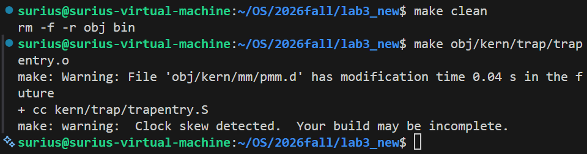
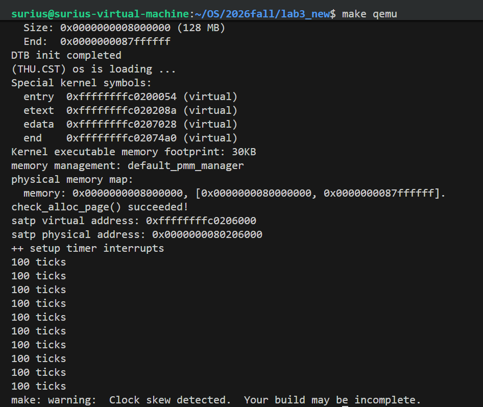
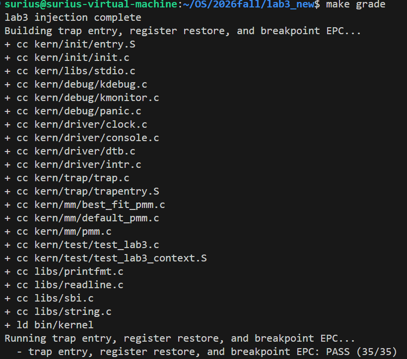
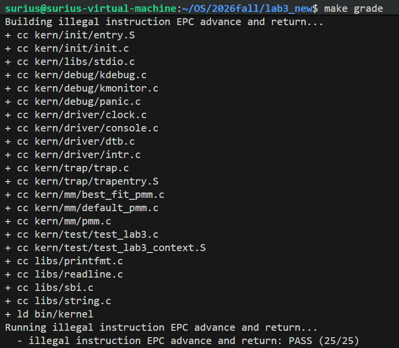
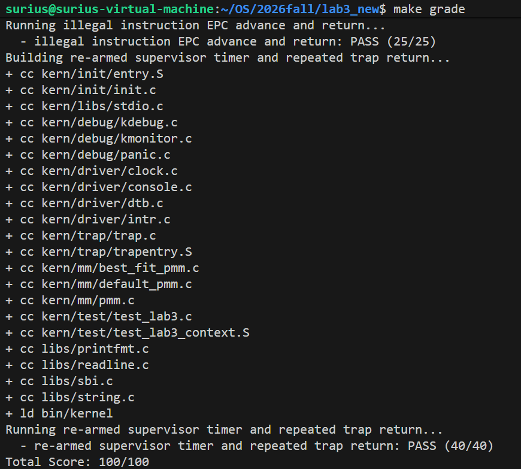

# 操作系统实验报告

## 实验基本信息

| 项目 | 内容 |
|------|------|
| **实验名称** | Lab 3: 断,都可以断 |
| **小组成员** | 2413993-徐锐、2413410-韩芳逸、2413340-戴璐 |
| **完成日期** | 2026-10-31 |

### 小组分工

练习如何分工？

| 成员 | 负责的练习/模块 |
|------|----------------|
| 2413993-徐锐 | 功能模块1 |
| 2413340-戴璐 | 功能模块2（exception_handler） |
| 2413410-韩芳逸 | 功能模块2（interrupt_handler） |

实验报告如何分工？

见下自述。

---

## 一、实验目的

<!-- 说明本次实验的主要目标和预期成果 -->

本实验的主要目的是：

- 理解、开发、检测中断处理机制。

---

## 二、实验环境

你们使用的 AI 工具

| 成员 | AI 编程工具 | 底层模型 | 备注 |
|------|------------|---------|------|
| 2413993-徐锐 | codex VScode插件，ChatGPT桌面版 | GPT6 |  |
| 2413340-戴璐 | codex VScode插件| GPT6| |
| 2413410-韩芳逸 |claude vscode插件 | deepseek-v4-flash| |

**说明：**
- **AI 编程工具**：指具体使用的终端工具、编辑器插件、桌面应用或浏览器界面
- **底层模型**：指该工具使用的大语言模型及版本

---

## 三、实验整体逻辑分析

### 3.1 本章节的逻辑主线

本章围绕 RISC-V 的中断与异常处理展开，解决内核如何响应 Trap、处理事件并恢复原执行流的问题，形成“保存现场 → 调用处理函数 → 处理中断或异常 → 恢复现场并返回”的完整流程。

### 3.2 功能的逐步实现

1. **完善 Trap 入口与恢复**：将现场传给 `trap()`，处理后恢复寄存器并返回，为具体事件处理建立通路。

2. **实现中断与异常处理**：分类处理 Trap，对非法指令和断点异常输出信息并更新 `epc`，保证返回后继续执行。

3. **完善时钟中断**：设置下一次时钟事件、累计计数、定期输出，并在达到规定次数后关机。

4. **理解中断保护并验证**：分析内存操作中的中断关闭与恢复，编译运行检查完整处理流程。


---

## 四、实验内容与实现

<!-- 
说明：本部分按照 exercises 文档中的练习顺序组织
每个功能模块或者练习中可能包含多项任务，请根据实际情况调整
-->

### 功能模块：Trap 上下文恢复与 Trap 入口功能

**负责人：** 2413993-徐锐

#### 模块功能描述

**需要实现/修改的函数(或汇编功能)：**

```asm
// 列出本模块涉及的所有函数签名
RESTORE_ALL
__alltraps
```

**功能说明：**

- **该模块在整个系统中的作用**：

  连接 Trap 入口、C 语言处理函数和上下文恢复，支持处理后返回原执行流。

- **需要处理的主要场景**：

  中断或异常发生时传递现场，处理结束后按 Trap frame 恢复寄存器和执行位置。

- **与其他模块的交互关系**：

  使用 `SAVE_ALL` 保存现场，调用 `trap()` 交给模块二处理，再通过 `RESTORE_ALL` 和 `sret` 恢复返回。

#### 最终提示词

以下是经过迭代优化后，最终成功实现该功能的提示词：

````markdown
## module1
### [PROMPT]
**任务**：实现 Lab3 的 `RESTORE_ALL` 和 `__alltraps`，完成“保存上下文 → 调用 C 语言处理函数 → 恢复上下文 → 按处理后的 Trap frame 恢复执行”的 Trap 处理流程。
**操作要求**：修改实际文件，仅补全 `lab3_new/kern/trap/trapentry.S` 中两处 `lab3 function1 YOUR CODE` 对应的 `RESTORE_ALL` 和 `__alltraps` 实现。保留标记注释；将 `YOUR CODE` 替换为`MY CODE:2413993`。
**输出要求**：完成文件修改后，在 `lab3_new` 下执行 `make obj/kern/trap/trapentry.o`，报告改动和编译结果。
### [RELY]
- `lab3_new/kern/trap/trapentry.S`：已有 `SAVE_ALL`、`__alltraps`、`__trapret` 和 `sret`。
- 现有 Trap frame 布局：以帧首地址为基址，第 `0` 至 `31` 个 `REGBYTES` 槽依次对应 `x0` 至 `x31`，第 `32` 至 `35` 槽依次为 `status`（`sstatus`）、`epc`（`sepc`）、`badvaddr`、`cause`。`SAVE_ALL` 通过 `sscratch` 保存分配帧之前的 `sp` 至第 `2` 槽，随后清零 `sscratch`。RV64 下 `REGBYTES=8`，帧大小为 288 字节。
- `lab3_new/kern/trap/trap.c`：`void trap(struct trapframe *tf)`。
- 工程提供 `LOAD`、`STORE`、`REGBYTES` 汇编宏，RV64 下分别对应 `ld`、`sd`、`8`。RISC-V 调用约定使用 `a0` 传递首参数，调用时 `sp` 须按 16 字节对齐；`sret` 根据 `sepc` 和 `sstatus` 恢复执行位置、特权级及中断状态。
### [GUARANTEE]
必须实现的接口：
```asm
.macro RESTORE_ALL
__alltraps:
```
- `RESTORE_ALL` 与现有 `SAVE_ALL` 的实际布局一致。
- `__alltraps` 将有效的 Trap frame 指针交给 `trap()`，处理完成后衔接已有 `__trapret` 返回流程。
- 修改范围限定为两处模块一待实现区域，保留其余代码、接口和数据布局。
### [SPECIFICATION]
#### RESTORE_ALL
**Pre-Condition**：`sp` 指向由 `SAVE_ALL` 建立的有效 Trap frame，`trap()` 已返回，帧中内容可能已被处理函数合法更新。
**Post-Condition**：可写通用寄存器及返回所需的 `sstatus`、`sepc` 与当前帧一致；`x0` 保持为零，`sp` 恢复为帧中保存的原栈指针，后续可执行 `sret`。
**Case 1**：处理函数未修改帧时，恢复被打断的寄存器状态，后续从帧中记录的执行位置继续运行。
**Case 2**：处理函数合法修改 `epc` 或其他可恢复字段时，使用修改后的值返回。
**Requirements**：正确恢复帧中保存的原 `sp`，在帧访问完成前保持基址有效；临时寄存器最终也须恢复。CSR 恢复范围为 `sstatus`、`sepc`，返回特权级由帧中的 `status` 决定。
#### __alltraps
**Pre-Condition**：处理器进入当前框架的 Trap 入口，内核栈有效且满足调用约定；已有 `SAVE_ALL` 可建立完整 Trap frame。
**Post-Condition**：`trap()` 被调用一次，首参数指向当前 Trap frame；其返回后，`sp` 仍指向该帧，执行流进入 `__trapret`，恢复现场并通过 `sret` 返回。
**Case 1**：发生中断时，C 处理函数能读取完整现场；处理完成后恢复现场并返回。
**Case 2**：发生异常且 C 处理函数更新帧中 `epc` 时，返回流程使用更新后的地址。
**Requirements**：遵守首参数及栈对齐约定，保留入口四字节对齐，保持 Trap frame 完整；中断和异常的具体处理交给 `trap()`。
````

#### 实现迭代过程

本模块的实现经历了 [1] 次迭代，过程如下：

---

##### 第一次迭代

如果设计的prompt生成代码后出现问题：

**遇到的问题：**

- 问题1：原来**任务**中写的是完成“保存上下文 → 调用 C 语言处理函数 → 恢复上下文 → 返回原执行流”流程，而后文提到允许处理函数修改 `epc`，AI认为这与"*返回原执行流*"这一说法有一定抵牾。

**问题解决策略：**

- 针对问题1：完成“保存上下文 → 调用 C 语言处理函数 → 恢复上下文 → 按处理后的 Trap frame 恢复执行”，让意思表述的更明确。

如果没有问题：

**最终结果：**

经过 [1] 次迭代，该模块最终：

- :white_check_mark: 编译通过

  

  `make obj/kern/trap/trapentry.o` 成功生成了目标文件。

- :question: 所有相关测试通过

  此处未运行测试

- :question: 功能符合预期

  此处尚未验证Trap功能

---

### 功能模块：中断处理（interrupt_handler）

**负责人：** 2413410-韩芳逸

#### 模块功能描述

**需要实现/修改的函数：**

```c
void interrupt_handler(struct trapframe *tf);
```

**功能说明：**

- **该模块在整个系统中的作用**：

  对 Trap 入口传递过来的中断按 `tf->cause` 进行分类处理，是中断从“进入内核”到“完成具体处理”的核心环节。功能模块二中的 `exception_handler()` 由组员负责，本部分只涉及中断处理。

- **需要处理的主要场景**：

  时钟中断需要设置下一次时钟事件、累计 `ticks`、每 `TICK_NUM` 次输出统计信息，并在累计输出达到 `SHUTDOWN_AFTER` 后关机；软件中断和外部中断只需给出类型提示；无法识别的中断输出提示并打印完整 Trap frame 以辅助调试。

- **与其他模块的交互关系**：

  `trap_dispatch()` 判断 `tf->cause` 最高位为 1 后调用本函数；本函数依赖 `clock_set_next_event()`、`ticks`、`print_ticks()`、`print_trapframe()` 和 `sbi_shutdown()`；处理完成后返回，由 `__trapret` 恢复现场并通过 `sret` 回到原执行流。

#### 最终提示词

以下是经过迭代优化后，最终成功实现该功能的提示词：

````markdown
## module2
### [PROMPT]
**任务**：修改 `kern/trap/trap.c`，实现 Lab3 功能模块二中的中断处理 `interrupt_handler()`，使内核能对时钟中断、各类软件/外部中断进行正确分类与处理，并能在处理完成后顺利返回 `__trapret`。
**操作要求**：必须修改项目中的实际文件。仅在 `//lab3 function2 YOUR CODE` 标记处补全 `interrupt_handler()`，并将该注释中的 `YOUR CODE` 替换为 `MY CODE:2413410`。保留其他所有已有函数与代码，不修改函数签名，不修改 `print_ticks()`、`trap_dispatch()`、`trap()` 等规定以外的函数；`exception_handler()` 不在本次任务范围内，不要实现或修改。
**输出要求**：直接进行文件操作，使用下面 [RELY]、[GUARANTEE]、[SPECIFICATION] 的信息，不引入无关功能。
### [RELY]
- `kern/trap/trap.h`：`struct trapframe { struct pushregs gpr; uintptr_t status, epc, badvaddr, cause; }`。
- `tf->cause` 最高位为 1 表示中断，低 63 位为中断原因编号。
- `kern/trap/trap.c` 已有：`#define TICK_NUM 100`、`static void print_ticks()`（输出 `100 ticks`）、`void print_trapframe(struct trapframe *tf)`。
- `libs/riscv.h`：`IRQ_U_SOFT=0`、`IRQ_S_SOFT=1`、`IRQ_M_SOFT=3`、`IRQ_U_TIMER=4`、`IRQ_S_TIMER=5`、`IRQ_M_TIMER=7`、`IRQ_U_EXT=8`、`IRQ_S_EXT=9`、`IRQ_M_EXT=11`。
- `kern/driver/clock.h`：`extern volatile size_t ticks;`、`void clock_set_next_event(void);`。
- `libs/sbi.h`：`void sbi_shutdown(void);`。
- 框架未预定义 `SHUTDOWN_AFTER`，需要在本文件中定义（取 10）。
### [GUARANTEE]
必须实现的接口（位置在 `trap_dispatch()` 之前）：
```c
void interrupt_handler(struct trapframe *tf);
```
可以添加 `static` 辅助变量或文件内宏，不得改变上述签名，不得新增其他对外接口。
### [SPECIFICATION]
#### interrupt_handler
**Pre-Condition**：`tf` 指向 `__alltraps` 保存的完整 Trap frame，`tf->cause` 最高位为 1，低 63 位为中断原因。
**Post-Condition**：对应中断已被处理；返回后 `trap()` 正常返回到 `__trapret`，上下文与 `ticks` 状态一致。
**Case 1（时钟中断 `IRQ_S_TIMER`）**：调用 `clock_set_next_event()` 设置下一次时钟事件；`ticks` 自增 1；当 `ticks % TICK_NUM == 0` 时调用 `print_ticks()` 输出一次统计信息；累计统计输出次数达到 `SHUTDOWN_AFTER` 后调用 `sbi_shutdown()`。
**Case 2（软件中断）**：对 `IRQ_U_SOFT`、`IRQ_S_SOFT`、`IRQ_M_SOFT` 分别输出对应的提示信息，其中 `IRQ_S_SOFT` 必须输出 `Supervisor software interrupt`。
**Case 3（其他可识别的中断）**：对用户/机器时钟中断、用户/监管者/机器外部中断输出对应的提示信息即可，不做额外处理。
**Case 4（无法识别的中断）**：输出 `Unknown interrupt: cause <原因编号>`，并调用 `print_trapframe(tf)` 输出完整 Trap frame。
**Requirements**：`ticks` 每收到一次时钟中断必须自增，且必须先设置下一次时钟事件再返回，否则只能收到一次时钟中断。
````

#### 实现迭代过程

本模块的实现经历了 1 次迭代，过程如下：

---

##### 第一次迭代

提示词一次生成后，`interrupt_handler()` 的逻辑即满足要求，未出现功能性问题。

**遇到的问题：**


**问题解决策略：**


**最终结果：**

经过 1 次迭代，该模块最终：

- `interrupt_handler()` 实现完成
- 待 `exception_handler()` 实现后，进行整机编译、`make qemu` 与 `make grade` 测试并补充截图

**关键改进点总结（如有）：**

1. [RELY] 中写明了 `tf->cause` 最高位为 1 表示中断的判定方式，避免 AI 直接拿带符号的 `cause` 做 `switch`。
2. [SPECIFICATION] 中明确要求先调用 `clock_set_next_event()` 再返回，避免只收到一次时钟中断。
3. 依据评分脚本的判定字符串，明确规定了 `Supervisor software interrupt`、`Unknown interrupt: cause <编号>` 等输出格式，以及未知中断需同时调用 `print_trapframe(tf)`。

---

### 功能模块：异常处理（exception_handler）

**负责人：** 2413340-戴璐

#### 模块功能描述

**需要实现/修改的函数：**

```c
void exception_handler(struct trapframe *tf);
```

**功能说明：**

``exception_handler()`` 负责处理实验要求的异常，其中非法指令异常和断点异常需要输出规定格式的信息，并根据对应指令的长度正确更新 tf->epc，使 Trap 返回以后不会重复执行已经触发异常的指令；其他未要求具体处理的异常则使用已有的 ``print_trapframe(tf) ``作为兜底处理。这个模块完成后，系统应能够对实验要求的时钟中断、非法指令异常和断点异常进行正确识别和处理。

#### 最终提示词

以下是经过迭代优化后，最终成功实现该功能的提示词：

````markdown
### [PROMPT]

**任务**：在 `lab3_new/kern/trap/trap.c` 中实现 Lab3 功能模块二的 `exception_handler()`。根据 `tf->cause` 处理非法指令异常、断点异常及其他异常，使已处理的异常能够衔接 Trap 返回流程。

**操作要求**：修改项目中的实际文件，仅在 `trap_dispatch()` 之前补全 `exception_handler()`。保留已有代码；`interrupt_handler()`、`trap_dispatch()`、`trap()` 等函数不在本次修改范围内。需要添加的代码注释使用中文。

**输出要求**：直接完成文件修改，并说明异常分类、输出格式和 `tf->epc` 更新方式；使用以下 [RELY]、[GUARANTEE]、[SPECIFICATION] 中的信息，不引入无关功能。

### [RELY]

- `kern/trap/trap.h`：`struct trapframe` 包含 `cause`、`epc` 等字段。`cause` 表示 Trap 原因，`epc` 记录触发异常的指令地址。
- `kern/trap/trap.c`：`trap()` 经 `trap_dispatch()` 将异常交给 `exception_handler(tf)`；已有 `print_trapframe(struct trapframe *tf)` 可输出完整 Trap frame，`cprintf()` 可输出提示信息。
- `libs/riscv.h`：`CAUSE_ILLEGAL_INSTRUCTION` 表示非法指令异常，`CAUSE_BREAKPOINT` 表示断点异常。
- 异常处理函数返回后，`__trapret` 根据 Trap frame 中的 `epc` 恢复执行位置。RISC-V 指令可能为 16 位压缩指令或 32 位指令，指令长度应依据触发异常的指令编码判断。

### [GUARANTEE]

必须实现的接口（位置在 `trap_dispatch()` 之前）：

```c
void exception_handler(struct trapframe *tf);
```

- 非法指令异常和断点异常须输出对应提示，并将 `tf->epc` 更新到触发异常的指令之后。
- 其他异常调用 `print_trapframe(tf)` 作为兜底处理，不擅自改变其执行位置。
- “整个模块不得修改函数签名，也不得修改 `trap.c` 中规定以外的其他函数。”

### [SPECIFICATION]

#### exception_handler

**Pre-Condition**：`tf` 指向 Trap 入口保存的完整 Trap frame；`trap_dispatch()` 已判定当前 Trap 为异常，`tf->cause` 为异常原因，`tf->epc` 指向触发异常的指令。

**Post-Condition**：异常已按类型处理。对于非法指令和断点异常，`tf->epc` 指向下一条指令；函数返回后，执行流可经 `trap()`、`__trapret` 恢复。对于其他异常，已输出完整 Trap frame。

**Case 1（非法指令异常 `CAUSE_ILLEGAL_INSTRUCTION`）**：输出以 `Illegal instruction at` 开头、包含异常指令地址的提示信息；根据该指令的实际长度将 `tf->epc` 增加 2 或 4 字节，避免返回后再次执行该指令。

**Case 2（断点异常 `CAUSE_BREAKPOINT`）**：输出以 `Breakpoint at` 开头、包含断点指令地址的提示信息；根据触发断点的指令实际长度更新 `tf->epc`，兼顾压缩断点指令与普通断点指令。

**Case 3（其他异常）**：调用 `print_trapframe(tf)` 输出完整现场；不将未规定处理的异常当作非法指令或断点异常，也不统一增加 `tf->epc`。

**Requirements**：判断指令长度时遵循 RISC-V 指令编码规则，不对所有异常固定使用相同的 `epc` 偏移量；输出异常地址时使用更新前的 `tf->epc`。

````

#### 实现迭代过程

本模块的实现经历了 1 次迭代，过程如下：

---

##### 第一次迭代

提示词一次生成后，`interrupt_handler()` 的逻辑即满足要求，未出现功能性问题。


**最终结果：**

经过 1 次迭代，该模块最终：
- ✅ 编译通过
- ✅ 所有相关测试通过
- ✅ 功能符合预期


---

### 练习：

**负责人：** 2413993-徐锐

**功能模块1**：见前[功能模块：Trap 上下文恢复与 Trap 入口功能](#功能模块：Trap 上下文恢复与 Trap 入口功能)

**功能模块2**：见前[功能模块：中断处理（interrupt_handler）](#功能模块：中断处理（interrupt_handler）)与[功能模块：异常处理（exception_handler）](#功能模块：异常处理（exception_handler）)

---

## 五、测试与验证

<!-- 根据该实验的具体情况，提供完整的测试运行截图，应包含：
- 编译及运行成功的输出（make qemu），可能有多个

  

- 测试通过的结果（make grade），只有一个

  这里内部分成三部分，较长，故有三张图（虽然是仅一次make grade）

  

  

  

---

## 六、实验总结与收获

### 对操作系统的理解

1. 列出你们认为本实验中重要的知识点，以及与对应的 OS 原理中的知识点，并简要说明二者的含义、关系和差异

   - **中断与异常**：对应 OS 的事件响应机制，本实验通过 RISC-V 的 Trap 入口和原因寄存器完成分类处理。
   - **上下文保存与恢复**：对应现场保护，本实验借助 Trap frame 保存寄存器，使处理后能够继续执行。
   - **时钟中断与中断屏蔽**：分别体现周期性事件处理和临界区保护，本实验实现计数输出，并在内存操作期间保存、关闭和恢复中断状态。

2. 列出你们认为 OS 原理中很重要、但在本实验中没有对应上的知识点

   **中断嵌套与优先级**：本实验未实现多级中断的嵌套处理。

   **时钟驱动的抢占调度**：本实验的时钟中断用于计数和关机，尚未用于切换任务。

### AI 协作开发的经验

编译通过不意味着功能成功，某些实际交付的功能我们还需要自行测试。

---

