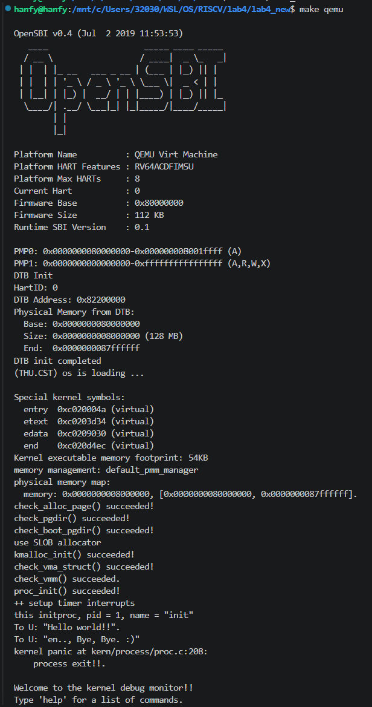
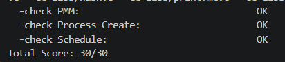

# 操作系统实验报告

## 实验基本信息

| 项目 | 内容 |
|------|------|
| **实验名称** | Lab 4: 进程管理 |
| **小组成员** | 2413993-徐锐、2413340-戴璐、2413410-韩芳逸 |
| **完成日期** | 2026-11-16 |

### 小组分工

练习如何分工？

| 成员 | 负责的练习/模块 |
|------|----------------|
| 2413993-徐锐 | 练习3和challenge |
| 2413340-戴璐 | 练习1和实验报告其他部分 |
| 2413410-韩芳逸 | 练习2和测试部分|


---

## 一、实验目的

<!-- 说明本次实验的主要目标和预期成果 -->

本实验的主要目的是：

- 了解虚拟内存管理的基本结构，掌握虚拟内存的组织与管理方式
- 了解内核线程创建/执行的管理过程
- 了解内核线程的切换和基本调度过程

---

## 二、实验环境

你们使用的 AI 工具

| 成员 | AI 编程工具 | 底层模型 | 备注 |
|------|------------|---------|------|
| 2413993-徐锐 | Codex  VsCode插件，ChatGPT桌面版 | GPT6 |  |
| 2413340-戴璐 |Codex |GPT6 | |
| 2413410-韩芳逸 |Claude Code（VS Code 扩展） |DeepSeek-V4-Flash | |

**说明：**
- **AI 编程工具**：指具体使用的终端工具、编辑器插件、桌面应用或浏览器界面
- **底层模型**：指该工具使用的大语言模型及版本

---

## 三、实验整体逻辑分析

### 3.1 本章节的逻辑主线

本章围绕虚拟内存管理与内核线程管理展开，解决内核已有物理页分配和基础页表能力、却尚不能可靠维护映射或调度多个执行流的问题。整体链路是“维护虚拟页映射 → 初始化进程管理并创建内核线程 → 选择可运行线程并切换上下文”。本实验的地址空间采用预映射方式，重点是映射维护和内核线程运行，尚不涉及缺页时按需分配、页面置换或用户进程执行。

### 3.2 功能的逐步实现

1. **完成虚拟内存页操作**：通过 `page_insert()`、`page_remove()` 建立、更新和撤销映射，同步维护物理页引用计数与 TLB 状态。可靠的页表映射是地址空间管理及后续线程运行的基础。

2. **初始化进程管理并创建线程**：在 `vmm_init()` 之后，由 `proc_init()` 建立 `idleproc` 和 `initproc`；`kernel_thread()`、`do_fork()` 等函数分配并初始化 PCB、内核栈和首次运行现场，使线程进入可调度状态。

3. **实现调度与上下文切换**：`cpu_idle()` 在需要重调度时进入 `schedule()`，选出可运行线程；`proc_run()` 切换当前线程及页表，`switch_to()` 保存旧上下文并恢复新上下文，让 `initproc` 真正获得 CPU。由此形成 `kern_init → pmm_init → vmm_init → proc_init → cpu_idle → schedule → proc_run → switch_to` 的主要执行链。

---

## 四、实验内容与实现

<!-- 
说明：本部分按照 exercises 文档中的练习顺序组织
每个功能模块或者练习中可能包含多项任务，请根据实际情况调整
-->

### 功能模块：虚拟内存页操作功能

**负责人：** 2413340-戴璐

#### 模块功能描述

**需要实现/修改的函数：**

```c
int page_insert(pde_t *pgdir, struct Page *page, uintptr_t la, uint32_t perm);(kern/mm/pmm.c)
void page_remove(pde_t *pgdir, uintptr_t la);(kern/mm/pmm.c)
```

**功能说明：**

[简要描述该模块的功能，包括：
- 该模块在整个系统中的作用
- 需要处理的主要场景
- 与其他模块的交互关系]
整个功能模块的具体功能为：这个模块负责在现有多级页表框架上完成最基本的映射维护，也就是把物理页挂到指定线性地址上，以及把已有映射安全地撤销掉。`page_insert` 负责建立或更新映射，`page_remove` 负责删除映射，它们共同决定一个线性地址最终对应哪一页物理内存，同时也决定物理页引用计数是否正确、页表状态是否一致、TLB 是否需要失效。这个模块完成后，页表测试、静态内核映射检查以及后续线程地址空间相关逻辑才有可靠基础。

整个功能模块应该满足的对外的接口为：对外只需要提供“建立映射”和“撤销映射”两个动作。`page_insert` 成功时应让指定线性地址稳定映射到目标物理页，并把权限位设置为调用者要求的状态；失败时应返回 `-E_NO_MEM`，且不能留下半完成映射。`page_remove` 则应作为一个幂等删除接口存在，目标地址有映射时删除映射、无映射时安静返回，不应把“未映射地址”当作异常情况。

#### 最终提示词

以下是经过迭代优化后，最终成功实现该功能的提示词：

````markdown

### [PROMPT]

**任务**：在 Lab4 工程 `code/lab4/lab4_new/kern/mm/pmm.c` 中实现功能模块一的 `page_insert()` 和 `page_remove()`，使 Sv39 页表能够建立、替换及撤销单页映射，并保持页表项、物理页引用计数和 TLB 状态一致。

**操作要求**：仅在 `//LAB4 function1 YOUR CODE` 对应的待实现区域补全这两个函数及必要的文件内辅助函数。保留现有函数签名、`get_pte()`、`tlb_invalidate()` 和其他代码；不修改模块二、模块三或报告文件。若项目约定需要标记代码归属，先沿用现有标记，不自行填写未经确认的学号。

**输出要求**：直接修改实际代码文件，说明同页重映射、异页替换、无映射删除和分配失败的处理方式，并报告实际完成的编译或测试结果；未执行的验证不要写成通过。

### [RELY]

- `kern/mm/pmm.h` 已声明 `int page_insert(pde_t *pgdir, struct Page *page, uintptr_t la, uint32_t perm)` 和 `void page_remove(pde_t *pgdir, uintptr_t la)`；`struct Page` 的 `ref` 表示引用计数，可用 `page_ref()`、`page_ref_inc()`、`page_ref_dec()` 操作。
- `get_pte(pgdir, la, create)` 返回目标页表项的内核虚拟地址；`create=1` 时可能分配中间级页表页，内存不足时返回 `NULL`；`create=0` 时只查找，不分配。
- `pte2page(*ptep)` 从有效页表项取得物理页；`page2ppn(page)` 和 `pte_create(ppn, perm)` 可构造页表项。`pte_create()` 已设置 `PTE_V`，不要把权限位误当成物理页号。
- `PTE_V` 表示有效映射；`PTE_U`、`PTE_W`、`PTE_R` 等权限位由调用者的 `perm` 指定。现有 `check_pgdir()` 会检查同一物理页映射到多个地址、异页替换及权限更新。
- `free_page(page)` 释放引用计数降为零的物理页；`tlb_invalidate(pgdir, la)` 可使对应线性地址的旧翻译失效；`-E_NO_MEM` 是内存不足的返回值，相关声明已由本文件现有头文件提供。

### [GUARANTEE]

必须实现以下接口，保持签名和返回类型不变：

```c
int page_insert(pde_t *pgdir, struct Page *page, uintptr_t la, uint32_t perm);
void page_remove(pde_t *pgdir, uintptr_t la);
```

- `page_insert()` 成功返回 `0`，目标地址映射到 `page`，叶子页表项采用新的 `perm`；无法取得页表项时返回 `-E_NO_MEM`，不得改变原叶子映射或错误修改数据页引用计数。
- `page_remove()` 对已映射地址撤销映射，对未映射地址安静返回；重复调用仍安全。
- 不新增对外接口；如需复用删除逻辑，可在待实现区域定义 `static` 辅助函数。

### [SPECIFICATION]

#### page_insert

**Pre-Condition**：`pgdir` 指向有效的页表根，`page` 指向待映射的物理页，`la` 是目标线性地址，`perm` 是调用者指定的叶子页表权限。

**Post-Condition**：成功时目标页表项指向 `page` 并具有新的权限；`page` 的引用计数按新增映射数变化，原页如被替换则正确减引用；对应 TLB 翻译已失效。失败时无新叶子映射，原映射及数据页引用计数保持不变。

**Case 1（原地址未映射）**：调用 `get_pte(pgdir, la, 1)` 定位或创建页表项；成功后给 `page` 增加一次映射引用，写入新的有效页表项。

**Case 2（原地址已映射同一物理页）**：只更新页表项权限并刷新该地址的 TLB；最终引用计数不变，不能先释放仍在使用的物理页。

**Case 3（原地址已映射另一物理页）**：撤销旧映射并将旧页引用计数减一，降为零时释放旧页；为新页增加一次映射引用，写入新页表项并刷新 TLB。操作顺序须避免旧页与新页引用计数错乱。

**Case 4（页表项获取失败）**：`get_pte(pgdir, la, 1)` 返回 `NULL` 时返回 `-E_NO_MEM`；不得覆盖原映射或增加新数据页引用。若本次调用已新建部分中间页表页，应清理该次调用遗留且未使用的页表页，避免半完成的页表结构。

#### page_remove

**Pre-Condition**：`pgdir` 指向有效页表根，`la` 为待删除映射的线性地址；该地址可以尚未映射。

**Post-Condition**：若原来存在有效映射，则叶子页表项清零，原物理页引用计数减一且在降为零时释放，对应 TLB 翻译失效；若不存在映射，则页表和引用计数不变。

**Case 1（有效映射）**：使用 `get_pte(pgdir, la, 0)` 查找，取得原物理页后撤销叶子页表项，再更新引用计数和 TLB。

**Case 2（无页表项或无效项）**：直接返回，不分配页表页、不对无效页表项调用 `pte2page()`。

**Requirements**：仅操作目标地址的叶子映射；保持同一物理页在多个地址映射时的引用计数正确；删除或更新有效映射后及时调用 `tlb_invalidate(pgdir, la)`。实现须满足现有 `check_pgdir()`、`check_boot_pgdir()` 中与映射和引用计数有关的断言。

````

#### 实现迭代过程

本模块的实现经历了 [N] 次迭代，过程如下：

---

##### 第一次迭代

如果设计的prompt生成代码后出现问题：

**遇到的问题：**
- 问题1：问题描述、错误信息和原因分析
- 问题2：问题描述、错误信息和原因分析

**问题解决策略：**
- 针对问题1：[说明如何修改提示词]
- 针对问题2：[说明如何修改提示词]

如果没有问题：

**最终结果：**

经过 [N] 次迭代，该模块最终：
- ✅ 编译通过
- ✅ 所有相关测试通过
- ✅ 功能符合预期

**关键改进点总结（如有）：**
1. [改进点1：例如，在 [RELY] 中补充了完整的系统调用号定义]
2. [改进点2：例如，在 [SPECIFICATION] 中明确了异常处理的边界条件]
3. [改进点3：例如，增加了对用户指针合法性检查的要求]

---

##### 第二次迭代（如有）

[按照和第一次迭代相同的格式]

---

##### 第三次迭代（如有）

[按照和第一次迭代相同的格式]

---

### 功能模块：进程创建及初始化功能

**负责人：** 2413410-韩芳逸

#### 模块功能描述

**需要实现/修改的函数：**

```c
static struct proc_struct *alloc_proc(void);(kern/process/proc.c)
void proc_init(void);(kern/process/proc.c)
int kernel_thread(int (*fn)(void *), void *arg, uint32_t clone_flags);(kern/process/proc.c)
int do_fork(uint32_t clone_flags, uintptr_t stack, struct trapframe *tf);(kern/process/proc.c)
static void copy_thread(struct proc_struct *proc, uintptr_t esp, struct trapframe *tf);(kern/process/proc.c)
static int copy_mm(uint32_t clone_flags, struct proc_struct *proc);(kern/process/proc.c)
```

**功能说明：**

这个模块负责把系统中“已经能运行内核代码”推进到“已经能创建并登记多个内核线程”。`alloc_proc` 负责得到一个干净的进程控制块，`proc_init` 负责把当前执行现场包装成 `idleproc` 并创建第一个真正的内核线程 `initproc`，`kernel_thread` 负责把函数入口和参数整理成线程首次运行所需的临时上下文，`do_fork` 负责把这些信息和内核栈、PID、链表、状态位等资源真正组合成一个可运行实体，`copy_thread` 负责把 trapframe 和 context 安放到新线程自己的内核栈上，而 `copy_mm` 则在当前实验阶段承担地址空间处理接口的占位作用。这个模块完成后，系统里至少要存在 `idleproc` 和 `initproc` 两个关键线程，并且 `initproc` 需要能够在后续调度中被真正切换执行。

模块与前后环节的关系是：它建立在功能模块一已经能够正确维护页表映射的基础上，向上为功能模块三提供“可被调度的线程对象”；本阶段创建的是共享内核地址空间的内核线程，因此 `copy_mm` 不做真正的用户地址空间复制，但必须保持完整函数形态，方便后续实验扩展。

#### 最终提示词

以下是经过迭代优化后，最终成功实现该功能的提示词：

````markdown
### [PROMPT]

**任务**：修改 Lab4 工程 `lab4_new/kern/process/proc.c`，实现“进程创建及初始化”功能模块。该模块负责把系统中“已经能运行内核代码”的状态推进到“能够创建并登记多个内核线程”：`alloc_proc()` 负责得到一个干净、安全的进程控制块；`proc_init()` 负责把当前执行现场包装成 `idleproc` 并创建第一个真正的内核线程 `initproc`；`kernel_thread()` 负责把函数入口和参数整理成线程首次运行所需的临时中断帧；`do_fork()` 负责把内核栈、PID、哈希表/链表和状态位组合成一个可运行实体；`copy_thread()` 负责把中断帧和上下文安放到新线程自己的内核栈上；`copy_mm()` 在本实验阶段承担地址空间处理接口的占位作用。

**操作要求**：你必须在项目中修改实际文件，而不是仅展示代码。只在 `kern/process/proc.c` 中 `//LAB4 function2 YOUR CODE` 标记处补全本模块，保留已有的 `set_proc_name()`、`get_proc_name()`、`get_pid()`、`forkret()`、`hash_proc()`、`find_proc()`、`setup_kstack()`、`put_kstack()`、`init_main()` 等现有代码，不要修改功能模块一、功能模块三或其他文件中的逻辑。不得删除现有注释与 `YOUR CODE` 标记。

**输出要求**：直接进行文件操作，使用下面 `[RELY]`、`[GUARANTEE]`、`[SPECIFICATION]` 部分的信息；以工程中的真实定义为准，不要引入本实验范围之外的用户进程、文件系统或调度策略逻辑。实现完成后报告实际编译与运行结果，未执行的验证不要写成通过。

### [RELY]

```c
// kern/process/proc.h
enum proc_state { PROC_UNINIT = 0, PROC_SLEEPING, PROC_RUNNABLE, PROC_ZOMBIE };
struct context { uintptr_t ra, sp, s0, s1, s2, s3, s4, s5,
                             s6, s7, s8, s9, s10, s11; };
struct proc_struct {
    enum proc_state state; int pid; int runs; uintptr_t kstack;
    volatile bool need_resched; struct proc_struct *parent;
    struct mm_struct *mm; struct context context; struct trapframe *tf;
    uintptr_t pgdir; uint32_t flags; char name[PROC_NAME_LEN + 1];
    list_entry_t list_link, hash_link;
};
#define PROC_NAME_LEN 15
#define MAX_PROCESS   4096

// kern/trap/trap.h：gpr 中 s0=x8、s1=x9、a0=x10、sp=x2
struct trapframe { struct pushregs gpr; uintptr_t status, epc, badvaddr, cause; };

// 常量
#define KSTACKPAGE 2
#define KSTACKSIZE (KSTACKPAGE * PGSIZE)
#define CLONE_VM   0x00000100
#define SSTATUS_SIE  0x00000002
#define SSTATUS_SPIE 0x00000020
#define SSTATUS_SPP  0x00000100
```

- 全局状态：`proc_list`、`hash_list[]`、`idleproc`、`initproc`、`current`、`nr_process`。
- 可直接调用：`kmalloc`/`kfree`；`setup_kstack`（设置 `kstack`，成功返回 0）/`put_kstack`；`get_pid`、`hash_proc`、`find_proc`（PID 与哈希表管理）；`set_proc_name`、`wakeup_proc`（置 `PROC_RUNNABLE`）；`list_init`、`list_add`（插到 `listelm` 之后）；`memset`。
- 关键符号：`boot_pgdir_pa`（内核页表根物理地址）、`bootstack`、`read_csr(sstatus)`；`kernel_thread_entry` 把 `s1` 移入 `a0` 后跳转 `s0`；首次运行链路为 `forkret → forkrets → __trapret`，其中 `forkret` 调用 `forkrets(current->tf)`。
- 错误码：`-E_NO_MEM`、`-E_NO_FREE_PROC`。

### [GUARANTEE]

必须实现或修改以下接口，签名和返回类型保持不变：

```c
static struct proc_struct *alloc_proc(void);
void proc_init(void);
int kernel_thread(int (*fn)(void *), void *arg, uint32_t clone_flags);
int do_fork(uint32_t clone_flags, uintptr_t stack, struct trapframe *tf);
static void copy_thread(struct proc_struct *proc, uintptr_t esp, struct trapframe *tf);
static int copy_mm(uint32_t clone_flags, struct proc_struct *proc);
```

你可以根据需要添加：

- `static` 辅助函数（只在本模块内部使用，不改变公开接口）
- 模块内部使用的宏定义或静态变量

不要新增对外接口，也不要修改 `proc.h` 中已有的函数声明。

### [SPECIFICATION]

#### alloc_proc

**Pre-Condition**：
- 物理内存分配器和 `kmalloc` 已经初始化，可以分配 `sizeof(struct proc_struct)` 字节的内存。

**Post-Condition**：
- 成功时返回一个所有字段都处于安全初始状态的 PCB；失败时返回 `NULL`。
- 新 PCB 尚未加入 `proc_list` 或 `hash_list`，也不持有内核栈。

**Case 1（分配成功）**：
- PCB 的全部字段先被清零，避免后续代码读到未初始化字段。
- 状态为 `PROC_UNINIT`，PID 为 `-1`，`runs`、`flags`、`need_resched` 为 0。
- `kstack` 为 0，`tf` 为 `NULL`，`parent`/`mm` 为 `NULL`。
- `pgdir` 指向内核当前页表的根物理地址 `boot_pgdir_pa`，因为当前阶段所有内核线程共享内核地址空间。
- `context` 中 `ra`、`sp` 等寄存器均为 0。

**Case 2（分配失败）**：
- 返回 `NULL`，不修改任何全局进程管理状态。

#### proc_init

**Pre-Condition**：
- `pmm_init()`、`vmm_init()` 已经完成，`bootstack` 可用，`kmalloc` 可用。
- 当前执行现场就是即将成为 `idleproc` 的内核上下文。

**Post-Condition**：
- `proc_list` 和 `hash_list` 全部初始化为空链表。
- `idleproc` 存在且可用：PID 为 0、状态为 `PROC_RUNNABLE`、`kstack` 为 `bootstack`、`need_resched` 已置位、`current == idleproc`。
- `initproc` 存在且可用：PID 为 1、状态为 `PROC_RUNNABLE`、`parent == idleproc`、`context.ra` 与 `context.sp` 均非 0，并已登记进 `proc_list` 和 `hash_list`。
- 两个线程都设置了可读的名字。

**Case 1（创建 idleproc）**：
- 使用 `alloc_proc()` 得到 PCB；它直接复用当前执行现场和启动栈，而不是通过 `do_fork()` 复制出来。
- 不能把 `idleproc` 加入 `proc_list`：调度器在找不到可运行线程时要把它作为保底线程使用，若它同时出现在就绪链表中会导致选择逻辑混乱。
- `nr_process` 需要把 `idleproc` 计入。

**Case 2（创建 initproc）**：
- 通过 `kernel_thread(init_main, "...", 0)` 创建；`kernel_thread` 返回新线程 PID，必须用 `find_proc()` 找到对应 PCB 并保存到 `initproc`。
- 创建失败时必须通过 `panic()` 终止初始化，不能留下只有 `idleproc` 的半初始化系统。

**Requirements**：
- `proc_init` 结束前 `current` 必须指向 `idleproc`，这样后续 `cpu_idle()` 和测试代码看到的当前线程才是正确的。
- `idleproc` 的 `need_resched` 必须置位，调度器第一次进入时才能切换到 `initproc`。

#### kernel_thread

**Pre-Condition**：
- `fn` 是合法的内核函数入口；`arg` 是传给它的参数；`do_fork()` 可用。

**Post-Condition**：
- 成功时返回新线程 PID；失败时返回 `do_fork()` 的负错误码。
- 新线程首次运行时从 `kernel_thread_entry` 进入，并以 `fn(arg)` 的形式执行。

**Case 1（正常创建）**：
- 构造一个临时 `struct trapframe` 并清零。
- `gpr.s0` 保存函数入口 `fn`，`gpr.s1` 保存参数 `arg`，`epc` 指向 `kernel_thread_entry`。
- `status` 从当前 `sstatus` 读取后设置 `SSTATUS_SPP` 和 `SSTATUS_SPIE`、清除 `SSTATUS_SIE`：首次 `sret` 返回内核态并打开中断，但构造线程期间保持关中断。
- 以 `clone_flags | CLONE_VM` 调用 `do_fork()`，内核线程的栈参数传 0。

**Case 2（do_fork 失败）**：
- 直接把负错误码返回给调用者，不修改全局状态。

#### do_fork

**Pre-Condition**：
- `current` 指向当前有效进程；`tf` 指向已经构造好的中断帧模板。
- 物理内存分配器和 `kmalloc` 可用。

**Post-Condition**：
- 成功时返回新进程 PID；新 PCB 已设置 `parent`、内核栈、中断帧、上下文、唯一 PID，并已加入 `proc_list` 与对应哈希链，状态为 `PROC_RUNNABLE`。
- 失败时返回负错误码，且不留下占用的 PCB、内核栈或链表节点。

**Case 1（进程数已达上限）**：
- `nr_process >= MAX_PROCESS` 时返回 `-E_NO_FREE_PROC`。

**Case 2（PCB 分配失败）**：
- `alloc_proc()` 返回 `NULL` 时返回 `-E_NO_MEM`。

**Case 3（内核栈分配失败）**：
- `setup_kstack()` 失败时释放刚分配的 PCB，返回 `-E_NO_MEM`。

**Case 4（地址空间处理失败）**：
- `copy_mm()` 失败时释放内核栈和 PCB，返回 `-E_NO_MEM`。

**Case 5（正常创建）**：
- 调用 `copy_thread()` 在新线程内核栈上放置中断帧和首次运行上下文。
- 在关中断的临界区内分配 PID、加入哈希表与 `proc_list`、递增 `nr_process`，保证其他执行流不会看到“有 PID 但尚未挂入链表”或“已挂入链表但 PID 未分配”的中间状态。
- 登记完成后调用 `wakeup_proc()` 把新进程置为就绪态。

**Requirements**：
- 失败路径必须严格配对：哪一步已经成功，就只释放哪些资源。
- 新进程加入 `proc_list` 的顺序要与后续调度器的遍历方式保持一致。

#### copy_thread

**Pre-Condition**：
- `proc->kstack` 已经指向一个完整的、未使用的内核栈。
- `tf` 是调用者提供的模板中断帧。

**Post-Condition**：
- `proc->tf` 指向新内核栈顶部的一块 `struct trapframe` 空间，其内容为模板的副本。
- `proc->context.ra == (uintptr_t)forkret`，`proc->context.sp == (uintptr_t)proc->tf`。
- `proc->tf` 中的 `gpr.a0` 为 0，表示子线程的返回值是 0。

**Case 1（内核线程，`esp == 0`）**：
- `gpr.sp` 设置为 `proc->tf`，使线程第一次运行时使用中断帧下方尚未使用的内核栈空间。

**Case 2（显式指定栈，`esp != 0`）**：
- `gpr.sp` 使用调用者传入的 `esp`。

**Requirements**：
- 中断帧必须放在内核栈顶部而不是覆盖正在使用的栈内容，且地址满足 RISC-V 的栈对齐要求。
- 首次运行链路必须是 `switch_to -> context.ra(forkret) -> forkrets(current->tf) -> __trapret`，不能直接让 `context.ra` 指向 `kernel_thread_entry`。

#### copy_mm

**Pre-Condition**：
- 本实验只创建内核线程，`current->mm == NULL`。

**Post-Condition**：
- 返回 0；`proc->mm` 仍为 `NULL`，不复制也不销毁任何用户地址空间。
- 函数保持完整形态，便于后续实验扩展为用户进程的 `mm` 复制。

**Case 1（当前阶段）**：
- 不执行任何地址空间操作，直接成功返回。

**Requirements**：
- 使用断言明确当前阶段只应处理内核线程，避免后续误以为这里真的复制了用户地址空间。

````

#### 实现迭代过程

本模块的实现经历了 1 次生成和 1 次独立验证，过程如下：

---

##### 第一次迭代：按规格生成

**最终结果：**

经过 [N] 次迭代，该模块最终：
- ✅ 编译通过
- ✅ 所有相关测试通过
- ✅ 功能符合预期

**实施要点（对照规格检查）：**

1. `alloc_proc()` 先 `memset` 整个 PCB，并把 `pgdir` 初始化为 `boot_pgdir_pa`，保证内核线程共享内核页表。
2. `proc_init()` 中 `idleproc` 直接复用当前现场和 `bootstack`，没有挂入 `proc_list`，只把 `initproc` 通过 `kernel_thread()` 登记进链表与哈希表。
3. `kernel_thread()` 构造 `s0=fn`、`s1=arg`、`epc=kernel_thread_entry` 的临时 trapframe，并把 `sstatus` 设置为 SPP=1、SPIE=1、SIE=0。
4. `do_fork()` 在关中断临界区内完成 PID 分配、哈希表/链表挂接和计数递增，失败路径按 `put_kstack()`、`kfree()` 的顺序严格回收。
5. `copy_thread()` 把 trapframe 放在内核栈顶部，设置 `a0=0`、`context.ra=forkret`、`context.sp=tf`，从而串起 `forkret -> forkrets -> __trapret` 的首次运行链路。

**关键改进点总结：**

1. 在 `[SPECIFICATION]` 中明确写出 `idleproc` 不进入 `proc_list`，避免 AI 按普通进程处理它，导致调度器保底逻辑和就绪链表重复。
2. 在 `[RELY]` 中给出 `kernel_thread_entry` 使用 `s0`/`s1` 的约定，避免生成错误的寄存器分配。
3. 在 `[SPECIFICATION]` 中要求首次运行链路必须经过 `forkret`，避免把 `context.ra` 直接设为线程函数入口而导致中断帧无法恢复。
4. 在 `[SPECIFICATION]` 中列出 `do_fork()` 的四种失败路径及资源配对，避免 PCB 或内核栈泄漏。

---

### 功能模块：进程调度

**负责人：** 2413993-徐锐

#### 模块功能描述

**需要实现/修改的函数：**

```c
// 列出本模块涉及的所有函数签名
void cpu_idle(void);(kern/process/proc.c)
void schedule(void);(kern/schedule/sched.c)
void proc_run(struct proc_struct *proc);(kern/process/proc.c)
void switch_to(struct context *from, struct context *to);(kern/process/switch.s)
```

**功能说明：**

[简要描述该模块的功能，包括：

- 该模块在整个系统中的作用
- 需要处理的主要场景
- 与其他模块的交互关系]

#### 最终提示词

以下是经过迭代优化后，最终成功实现该功能的提示词：

````markdown
### [PROMPT]
在 `code/lab4/lab4_new` 中实现 Lab 4 功能模块三。仅修改 `kern/process/proc.c`、`kern/schedule/sched.c` 和 `kern/process/switch.S` 中标有 `LAB4 function3` 的区域。
直接修改源码。模块二就绪后执行 `make qemu` 和 `make grade`，确认 `initproc` 实际执行到 `init_main`。报告实际验证结果及未完成验证的原因。
### [RELY]
- 模块二负责初始化 `idleproc`、`current` 和 `proc_list`，创建可运行的 `initproc`，并准备首次执行所需的 `context` 和 `trapframe`。
- 调度使用 `PROC_RUNNABLE`、`need_resched`、`runs`、`list_next()` 和 `le2proc()`。临界区使用 `local_intr_save()` 和 `local_intr_restore()`。
- `proc->pgdir` 保存页表根物理地址。Sv39 的 `satp` 写法参考 `enable_paging()`，写入后调用 `flush_tlb()`。
### [GUARANTEE]
保持四个接口的签名和调用约定。调度和切换的关键步骤在关中断状态下执行，各调用在返回时恢复进入前的中断状态。切换后 `current`、页表和寄存器上下文属于同一目标线程。
### [SPECIFICATION]
#### cpu_idle
- **Pre-Condition**：当前线程为已初始化的 `idleproc`。
- **Post-Condition**：持续循环。
- **Case**：`current->need_resched` 为真时调用 `schedule()`，否则继续等待。
#### schedule
- **Pre-Condition**：`current`、`idleproc` 和 `proc_list` 已初始化。
- **Post-Condition**：清除当前线程的 `need_resched`，选中线程的 `runs` 加一。选中不同线程时调用 `proc_run()`。
- **Case**：当前为 `idleproc` 时从链表头开始，否则从当前节点的下一项开始循环扫描。选中首个 `PROC_RUNNABLE` 线程，找不到时选 `idleproc`。
#### proc_run
- **Pre-Condition**：目标线程可运行，页表根和上下文已准备好。
- **Post-Condition**：目标线程接管 CPU。原线程恢复执行后，恢复其进入本函数前的中断状态。
- **Case**：目标等于 `current` 时直接返回。否则在关中断后保存原 `current`、更新 `current`，按 `((uint64_t)SATP_MODE_SV39 << 60) | (proc->pgdir >> RISCV_PGSHIFT)` 写入 `satp`，刷新 TLB 后调用 `switch_to()`。禁用遗留的 `lsatp()` 写法。
#### switch_to
- **Pre-Condition**：`a0`、`a1` 分别指向原线程和目标线程的 `struct context`。
- **Post-Condition**：按结构体布局保存原线程的 `ra`、`sp` 和 `s0–s11`，恢复目标线程的对应寄存器并执行 `ret`。
- **Case**：已运行线程从原调用点继续。新线程经 `forkret → forkrets → __trapret` 恢复至 `kernel_thread_entry`。
````

#### 实现迭代过程

本模块的实现经历了 0 次迭代，

如果没有问题：

**最终结果：**

经过 0 次迭代，该模块最终：

- ✅ 编译通过
- ✅ 所有相关测试通过
- ✅ 功能符合预期

---

### 练习：

**负责人：** [学号-姓名]，2413993-徐锐

见前功能模块部分有实现。

---

### Challenge：扩展练习

**负责人：** 2413993-徐锐


1. 说明语句 `local_intr_save(intr_flag); ... local_intr_restore(intr_flag);` 是如何实现开关中断的。

   答：修改 `sstatus` 寄存器的第 1 位（从 0 开始编号），即`SIE`。关中断`local_intr_save(intr_flag)`将其清零(这里会保存关中断前原状态，因为关中断操作可能迭代)，开中断`local_intr_save(intr_flag)`将其置1.

2. 深入理解不同分页模式的工作原理（思考题）。

`get_pte()` 函数位于 `kern/mm/pmm.c`，用于在页表中查找或创建页表项，从而实现对指定线性地址对应的物理页的访问和映射操作。这在操作系统的分页机制下，是虚拟内存与物理内存建立映射关系的关键基础。

- `get_pte()` 函数中有两段形式类似的代码，结合 `sv32`、`sv39`、`sv48` 的异同，解释这两段代码为什么如此相像。

  **这两段在 Sv39 页表的不同层重复同一个操作：检查当前表项是否有效，缺少下一级页表时按需创建。**

  - **第一段检查 `\*pdep1 & PTE_V`**。`pdep1` 是用 `PDX1(la)` 选出来的**根页表项**。若该项无效且 `create=1`，就用 `alloc_page()` 分配一页，清零后把新页表的物理页号写入 `*pdep1`。这样根页表项就指向了**中间页表**。
  - **第二段检查 `\*pdep0 & PTE_V`**。代码沿 `*pdep1` 找到中间页表，再用 `PDX0(la)` 选出其中一项。若该项无效且 `create=1`，就重复同样的分配、清零和写入操作。这次 `*pdep0` 指向的是**末级页表**。

  最后，代码用 `PTX(la)` 取出末级页表中目标 PTE 的地址。三级页表用了三个下标，但从第一张表走到第三张表跨两次，所以代码中有两段相似的处理。

  结合三种分页模式来看，对 **4 KiB 普通页**，虚拟地址的低 12 位都是页内偏移。前面的索引每一段负责在一级页表中选一项：

  - **Sv32** 有两个 10 位索引，走两级页表，到末级前下探**一次**。
  - **Sv39** 有三个 9 位索引，走三级页表，到末级前下探**两次**，正好对应这两段代码。
  - **Sv48** 有四个 9 位索引，走四级页表，到末级前下探**三次**。如果按本实验的写法实现，就会再多一段同样的处理。

  两段代码相似是因为多级页表的每一次下探都遵循同样的规则，变的只是当前所在的层级和用来取表项的下标。

- 目前 `get_pte()` 函数将页表项查找和页表页分配合并在一个函数里，你认为这种写法好吗？有没有必要把两个功能拆开？

  我认为没有问题，没必要拆开，分开的话维护成本更高。

---

## 五、测试与验证

<!-- 根据该实验的具体情况，提供完整的测试运行截图，应包含：
- 编译及运行成功的输出（make qemu），可能有多个
- 测试通过的结果（make grade），只有一个
-->

### 功能模块二测试记录

功能模块三（调度与上下文切换）尚未合入时，完整链接会因 `cpu_idle()` 未定义而失败，这属于模块三的交付内容。为单独验证模块二，在临时副本中仅加入模块三的空占位函数后编译并运行 QEMU，注入的进程创建测试输出如下：

```text
proc_init() succeeded!
[Test Process Create] PASS
```

该测试验证了 `current == idleproc`、`idleproc` 的 PID/状态/内核栈/父子关系，以及 `initproc` 的 PID、就绪状态、父子关系和首次运行上下文均满足要求。功能模块三合入后，完整的 `make grade` 已通过，`[Test PMM]`、`[Test Process Create]`、`[Test Schedule]` 三组测试均正常。

**测试截图：**

`make qemu` 运行结果（初始化完成后切换到 `initproc`，执行 `init_main` 并输出预期字符串）：



`make grade` 测试结果（PMM、Process Create、Schedule 三组测试全部通过，总分 30/30）：



---

## 六、实验总结与收获

### 对操作系统的理解

1. 本实验中重要的知识点及其对应的 OS 原理：

   - **页表映射与虚拟内存**：`page_insert()`、`page_remove()` 维护虚拟页到物理页的映射、引用计数和 TLB；这对应 OS 的地址转换与内存管理。`mm_struct`、`vma_struct` 描述地址空间中的区域，页表则记录具体页面映射，两者描述的层次不同。本实验采用预映射，尚未实现缺页时按需分配。
   - **PCB 与内核线程**：`proc_struct` 保存线程状态、内核栈和运行现场，`do_fork()` 等函数创建可运行线程；这对应 OS 用控制块管理执行实体的原理。本实验创建的是在内核态运行的 `idleproc`、`initproc`，没有完整实现用户进程的独立地址空间和用户态执行。
   - **调度与上下文切换**：`schedule()` 选择可运行线程，`proc_run()` 切换当前线程和页表，`switch_to()` 保存、恢复寄存器；这对应 OS 的 CPU 分时复用。调度决定“运行谁”，上下文切换负责“怎样接着运行”，两者分工不同。

2. OS 原理中重要、但本实验尚未对应实现的知识点：

   - **缺页异常、按需分配与页面置换**：本实验主要维护已有映射，没有实现缺页后分配页面或内存不足时置换页面。
   - **用户进程隔离与系统调用**：本实验以创建和调度内核线程为主，尚未完整实现用户程序装载、用户态与内核态切换及系统调用接口。

### AI 协作开发的经验

本实验中，AI 多次未能找到本机 Ubuntu 环境中已配置的 RISC-V 工具链，因而无法直接完成编译和运行验证。项目文件可在 Windows 侧访问，但 Makefile 调用的 `riscv64-unknown-elf-gcc`、`qemu-system-riscv64` 等工具需要在配置好的 Ubuntu 环境中运行；如果 AI 在另一终端环境里执行 `make`，出现“命令不存在”并不能说明代码本身有错。

这让我们认识到，向 AI 提供代码之外，还应明确**使用哪个终端、项目在该环境中的路径，以及工具链是否在 `PATH` 中**。遇到编译失败时，先检查当前环境和工具命令，再分析源码错误；AI 给出的“编译通过”或“测试通过”也应以实际运行记录为依据。AI 适合协助分析和修改代码，但本机环境的定位与最终验证仍需要我们主动核对。

---

